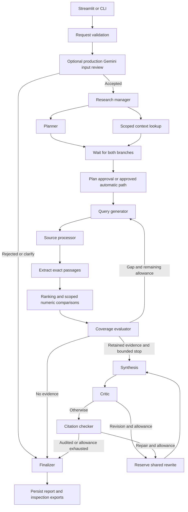
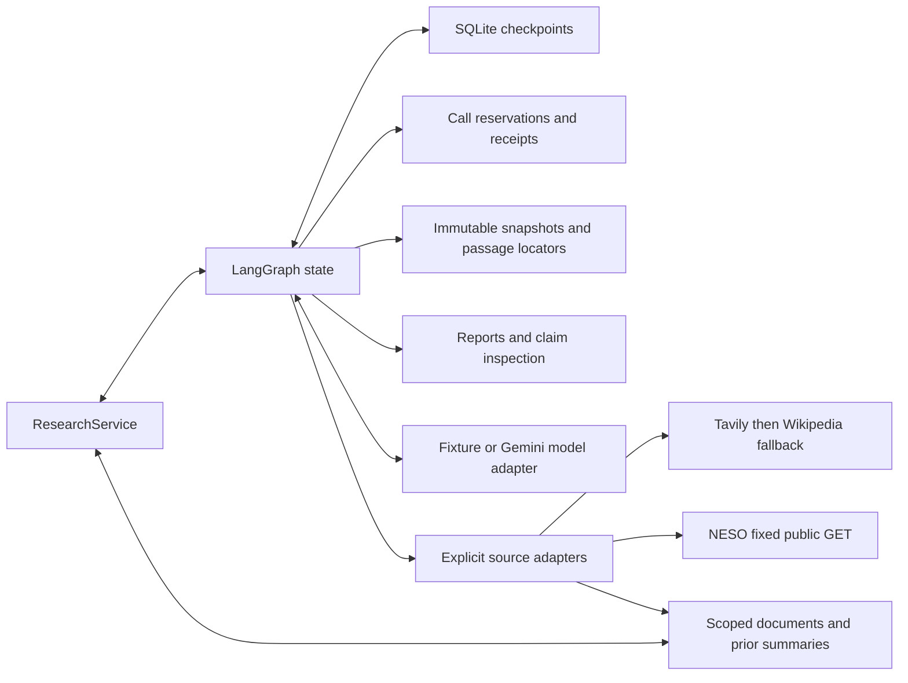
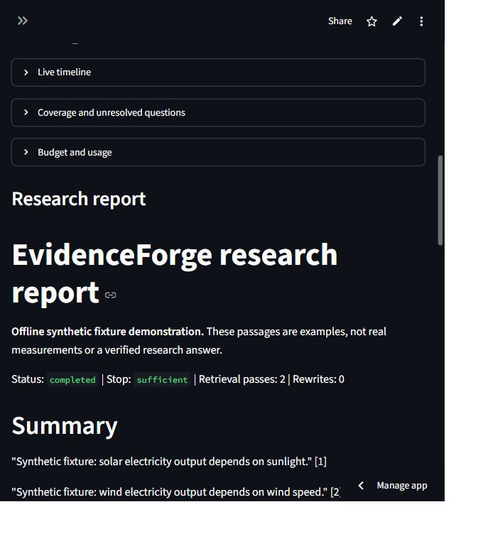

# 🔎 EvidenceForge AI

[](https://github.com/cakhiltej9001-source/evidenceforge-ai/actions/workflows/ci.yml)


> A local research workbench that plans questions, gathers inspectable evidence,
> follows coverage gaps and produces reports with traceable quotations.

EvidenceForge helps a reviewer inspect **how a report was produced**: which
questions were investigated, which passages were retained, where claims came from,
and why the workflow completed or stopped. Python, LangGraph, SQLite and Streamlit
connect the research stages; offline fixtures support demonstrations and optional
Gemini reasoning supports explicitly started provider runs.

**Current verification:** 547 source tests and both private CI jobs passed,
including Docker persistence, backup/restore and authenticated gateway checks.
The fresh 12 October run completed all six Gemini roles and one Tavily search,
retaining three NASA sources and two exactly cited claims. Offline review verified
all audits and fresh-process reconnect with zero network attempts. LangSmith
synthetic delivery/readback passed. Compact selections, structured domain filters
and report presentation fixes are implemented; flattened tables and semantic
completeness remain limits. New contract-version-6 runs preserve consistent pipe/tab table headers and rows,
reject ambiguous numeric rows even with line breaks, scope missing-data evidence
to the requested subject clause, and retain useful prose after exercise blocks.
These bounded rules do not establish general semantic accuracy. See
[current fixes and measured verification](docs/FINAL_STATUS_2026-10-13.md).

**Hosted app:** [Open EvidenceForge on Streamlit](https://evidenceforge-ai-akhiltej.streamlit.app/).
[Public live mode](docs/STREAMLIT_PUBLIC_LIVE_2026-10-13.md) uses privately
configured Gemini and Tavily keys without a password, as requested by the owner.
Create a plan, review it and approve it. Each browser session has its own scope.
Hosting remains free only (INR 0/month); provider usage may consume credits.
Hosted storage is temporary. The local workbench keeps durable research.
An explicit offline demo mode remains available. Repository access is private.
[Actual hosted live form and six passing UI checks](docs/HOSTED_LIVE_READY_2026-10-14.md)
were verified on 14 October 2026 without research calls.
[Three subsequent actual hosted Gemini/Tavily tests with screenshots](docs/HOSTED_LIVE_TESTS_2026-10-14.md)
used 13 Gemini calls and 2 searches: one completed, one was partial and one failed
before retrieval. The report documents these failures and measured usage.
[Failure explanations and explicit recovery controls](docs/HOSTED_RECOVERY_2026-10-14.md)
offer a new Gemini attempt or quoted source passages without Gemini. Each action
preserves earlier usage and still requires plan approval.
[Live rose recovery results and screenshots](docs/ROSE_RECOVERY_2026-10-14.md)
used 3 Gemini calls and 1 Tavily search. Source-only recovery completed; Gemini
review passed but query preparation returned HTTP 503. The combined planning
repair passed 540 source tests. A [fresh live test on 15 October](docs/LIVE_ROSE_SUCCESS_2026-10-15.md)
completed all five Gemini stages and one Tavily search locally, with six supported
exact citations and zero tool errors. The new hosted build was observed after reboot.
[Explicit source selection](docs/SOURCE_SELECTION_FIX_2026-10-15.md) now blocks
real research without a selected source before any API call. Synthetic examples
require choosing Synthetic demonstration. Hosted version 2026-10-15.1 and its source guard
were verified after reboot with zero provider calls.
[Saved-source access for blocked publisher links](docs/BLOCKED_SOURCE_FIX_2026-10-16.md)
lets in-app citations open the retained passages and download their exact text.
Original website links remain separate. Build 2026-10-16.1 passed full CI;
its hosted activation is awaiting an owner reboot.
See the [14 October hosted configuration repair](docs/HOSTED_CONFIG_FIX_2026-10-14.md)
and [current phase status](docs/FINAL_STATUS_2026-10-13.md). Actual hosted
[Markdown/JSON downloads and fresh-visitor isolation](docs/HOSTED_DOWNLOAD_VERIFICATION_2026-10-08.md) passed; full source CI passed 547 tests.

## ✨ Project at a glance

| Area | Details |
| --- | --- |
| Problem | Research answers are difficult to review when their evidence, gaps and execution history are hidden |
| Intended users | Students, developers and reviewers exploring an inspectable research workflow |
| Input | A research question, optionally selected PDF/DOCX/TXT documents and explicitly enabled live sources |
| Output | Markdown/JSON report, retained source passages, claim inspection, usage and stop reasons |
| Workflow | Plan → approve → retrieve → extract → evaluate coverage → synthesize → critique → audit |
| Reasoning | Deterministic offline fixtures or configured Gemini structured generation |
| Sources | Local documents, optional Tavily/Wikipedia web retrieval and NESO GB energy data |
| Storage | Scoped SQLite checkpoints, durable call receipts and immutable source snapshots |
| Interface | CLI plus optional Streamlit workbench |
| Evaluation | Offline regression and a frozen 20-case, 40-answer controlled Gemini comparison |
| Deployment | Public Streamlit live mode with browser-session scopes; explicit offline demo; durable local installation; constrained Docker and authenticated gateway verified in private CI |

## 🧠 Architecture

The manager starts planning and scoped-context lookup in parallel. Both branches
finish before plan approval and query generation. Coverage gaps can trigger another
retrieval pass; criticism and citation repair share one bounded rewrite allowance.



This summarizes healthy paths. Cancelled/error states route to finalization;
synthesis failures use an existing draft only when one exists. The service also
performs deterministic input checks before graph invocation. Semantic input review
is enabled for production-policy Gemini runs, while offline/legacy paths preserve
their behavior. [Full routing](src/evidenceforge/graph/research.py) and
[detailed architecture](docs/submission/ARCHITECTURE.md) show these boundaries.

### Storage and provider boundaries



- **Before provider work:** reserve the operation against configured allowances.
- **On restart:** reuse completed receipts; failed or uncertain paid outcomes block
  automatic replay. Supported checkpoints preserve their registered options.
- **At delivery:** keep audited claims and disclose unresolved criteria. Terminal
  outcomes include completed, partial, insufficient evidence, failed and cancelled.
- **At the network boundary:** live-source flags are separate from model selection.
  Selecting Gemini does not automatically enable web search.
- **For optional container access:** Caddy fronts loopback-only Streamlit. Health
  remains public; configured browser routes require authentication. The future
  Render template also requires the app's PBKDF2 login secret.

### Code map

| Responsibility | Files |
| --- | --- |
| UI and local launcher | [ui.py](src/evidenceforge/ui.py), [ui_launcher.py](src/evidenceforge/ui_launcher.py) |
| Run lifecycle, checkpoints and reconnect | [services/research.py](src/evidenceforge/services/research.py) |
| Routing and state reducers | [graph/research.py](src/evidenceforge/graph/research.py), [graph/reducers.py](src/evidenceforge/graph/reducers.py) |
| Planning, queries and context | [nodes/planner.py](src/evidenceforge/nodes/planner.py), [nodes/queries.py](src/evidenceforge/nodes/queries.py), [nodes/context.py](src/evidenceforge/nodes/context.py) |
| Retrieval and exact extraction | [nodes/sources.py](src/evidenceforge/nodes/sources.py), [nodes/extraction.py](src/evidenceforge/nodes/extraction.py) |
| Coverage, criticism and citation checks | [nodes/quality.py](src/evidenceforge/nodes/quality.py) |
| Provider reasoning | [models/gemini.py](src/evidenceforge/models/gemini.py) |
| Evidence retention and reports | [evidence/retention.py](src/evidenceforge/evidence/retention.py), [reporting.py](src/evidenceforge/reporting.py) |

## 📸 Working application

The Streamlit workbench supports question entry, plan editing and approval,
progress/coverage inspection, cancellation, checkpoint reconnect, document upload,
claim inspection and report downloads.

**Verified hosted screenshot:** the public Streamlit workflow completed on
6 October 2026 with two retrieval passes, two citation checks and no tool errors.
This is a synthetic demonstration, not real measurements.



### Run an offline demonstration

```powershell
uv sync --locked --extra ui
uv run --locked --extra ui evidenceforge-ui
```

Open `http://127.0.0.1:8501` on the same computer. Select offline reasoning and the
second-pass fixture, enter “Compare solar and wind electricity output,” then review
and approve the current plan. Inspect the timeline, evidence passages, locators and
final report. Keep live-source choices off for this demonstration.

A separate captured replay demonstrates four **executed synthetic scenarios**:

```powershell
uv run --locked python scripts/prepare_demo.py
uv run --locked python -m http.server 8503 --bind 127.0.0.1 --directory .evidenceforge/demo/phase11
```

Open `http://127.0.0.1:8503`. Click a finding to inspect its passage, source and
selected support graph. The coverage scenario completes after two passes; the
numeric dispute stays partial; a deliberately injected unsupported draft is repaired;
a pass-limited run discloses its gap. Stop the replay server with Ctrl+C.

See the [4 minute 30 second demo script](docs/submission/DEMO.md) and an actual
[saved synthetic report](docs/examples/phase6/report.md). Fixture statements are
examples, not measurements or verified facts. The replay serves only its generated
directory, not the complete private data root.

## 👋 Concepts explained

| Concept | Plain explanation | How this project uses it |
| --- | --- | --- |
| Research planning | Turn a broad question into smaller questions and criteria | Structured planner output, editable before approval |
| Retrieval-augmented generation | Give a model selected external passages before it writes | Gemini receives retained evidence rather than unrestricted search tools |
| Adaptive coverage | Check which criteria have evidence and investigate remaining gaps | Bounded follow-up retrieval passes |
| Snapshot and locator | Save the text and where a passage came from | Content hash plus exact offsets/page/paragraph metadata |
| Citation audit | Check that the quoted claim exists in retained evidence | Exact text, IDs, locator and snapshot validation |
| Checkpoint | Save graph execution state so a process can reconnect | SQLite run registration and thread checkpoints |
| Durable receipt | Save whether a provider operation ran and what it returned | Completed-response reuse and uncertain-call protection |
| Prior context | Earlier summaries can help orient a new run | Summaries are context; they are not admitted as fresh evidence |
| Claim graph | Show selected claims and their supporting records | A projection for inspection, not a second truth database |

A node is a function, not necessarily a separate AI agent or paid model request.
Context lookup, extraction and citation checks use application code. The successful
production factor workflows in the comparison used six model stages, including
semantic input review; their other nodes did not add model calls.

**What citations prove:** a checked snapshot contains the retained quotation.
They do not prove that the original source is true, independent or complete.
Ranking, lexical relevance and numeric dispute rules remain inspectable heuristics.

## 🛠️ Technology choices

| Technology | Why it is used | Tradeoff |
| --- | --- | --- |
| Python / Pydantic | Typed contracts, parsing and validated structured responses | Validation cannot establish semantic truth |
| LangGraph | Explicit branches, joins, loops and resumable execution | Graph changes need checkpoint compatibility controls |
| SQLite | Local checkpoints, scoped storage and durable operation receipts | Designed here for a trusted local workbench, not a distributed service |
| uv and uv.lock | Reproducible dependency installation and packaging | Use supported Python versions and the retained lock |
| Streamlit | A small service-backed interface for inspecting runs | UI jobs execute in-process; a separate CLI queues durable offline jobs |
| Gemini | Optional structured planning, coverage, synthesis and criticism | Availability, latency and usage limits vary |
| HTTPX / source adapters | Bounded streamed responses, typed failures and explicit endpoints | Live access and research quality require separate checks |
| pypdf / python-docx | Located PDF/DOCX extraction alongside TXT; optional local OCR | OCR requires Python 3.12 and original-page checks |
| Docker / Caddy | Repeatable constrained execution and protected container routes | Hosted persistence must still be verified on an actual platform |

Document lookup is lexical. Coverage loops, exact evidence records and durable
research execution are the main workflow mechanics.

## 💻 Local setup

Use Python 3.12 for the tested setup; package metadata permits 3.12 through 3.14.
An authorized GitHub account is required to clone this private repository.

```powershell
git clone https://github.com/cakhiltej9001-source/evidenceforge-ai.git
cd evidenceforge-ai
uv sync --locked --extra ui
if (-not (Test-Path .env)) { Copy-Item .env.example .env }
uv run --locked evidenceforge-check
uv run --locked --extra ui evidenceforge-ui
```

The example dotenv defaults to fixtures. The conditional copy preserves existing
private configuration. Environment variables override dotenv settings. Diagnostic
commands omit credential values.

### CLI, documents and restart

```powershell
uv run --locked evidenceforge-research "Compare solar and wind electricity output." --demo second-pass --offline
uv run --locked evidenceforge-ingest tests/fixtures/documents/energy.txt --owner demo
uv run --locked evidenceforge-research "Compare solar and wind electricity output." --owner demo --document DOCUMENT_ID --offline
uv run --locked evidenceforge-research "Compare solar and wind electricity output." --demo second-pass --require-approval --offline
uv run --locked evidenceforge-research --resume THREAD_ID --approve-plan 1 --offline
```

Replace IDs with the preceding command outputs. Use the same owner and data
folder on reconnect. A plan edit creates a new version needing approval. Save the
whole ignored `.evidenceforge` directory when backing up this local installation.
Stopping/restarting the UI preserves saved research, though active work may be
interrupted. Owner scopes isolate storage; they are not login identities.

### Optional local PDF OCR and offline jobs

For textless PDF pages, use Python 3.12 and opt in to local OCR:

```powershell
uv sync --locked --python 3.12 --extra ui --extra ocr
uv run --locked --python 3.12 --extra ocr evidenceforge-ingest "path/to/scan.pdf" --owner demo --ocr
```

OCR runs in a bounded CPU child process. Defaults allow five pages, four million
pixels per page, 120 seconds and 200 KB of text. OCR quotations refer to a labeled
machine transcript; check wording, numbers and layout against the PDF page image.
DOCX table rows retain cell alignment and row locators.

The separate SQLite queue persists offline fixture jobs in the local data folder:

```powershell
uv run --locked python -m evidenceforge.offline_jobs --data-dir .evidenceforge --owner demo enqueue "Compare solar and wind electricity output." --demo second-pass
uv run --locked python -m evidenceforge.offline_jobs --data-dir .evidenceforge --owner demo worker
uv run --locked python -m evidenceforge.offline_jobs --data-dir .evidenceforge --owner demo status JOB_ID
```

Each worker claims one job and exits. Review the returned thread's plan in the
local workbench before using `approve JOB_ID --plan-version VERSION`, then invoke
the worker again. Expired leases require explicit recovery; see
[setup commands](docs/submission/SETUP.md). Workers reject paid/live profiles.

Generated plans for annual requests or requests naming a year reject newly added
subannual requirements. Explicit breakdown preferences remain allowed. Date and
season context authorize only relevant measurements; finer added breakdowns stay
guarded. Other scope changes still need plan review.

### Optional Gemini and live sources

Privately configure `.env` only when using provider-backed runs:

```dotenv
EVIDENCEFORGE_MODEL_PROVIDER=gemini
EVIDENCEFORGE_MODEL_ID=gemini-3.1-flash-lite
EVIDENCEFORGE_MODEL_API_KEY=YOUR_PRIVATE_GEMINI_KEY
EVIDENCEFORGE_TAVILY_API_KEY=YOUR_PRIVATE_TAVILY_KEY
```

The [latest live review](docs/LIVE_GEMINI_TAVILY_REVIEW_2026-10-11.md)
verified a completed `gemini-3.1-flash-lite` workflow with one fresh Tavily search:
six valid structured responses, three exact claims and complete citation audits.
The earlier malformed-ID failure remains preserved; the successful repeat does
not establish broad reliability. The report still needs readability and
source-difference improvements. The ignored local `.env` selects 3.1 for new
work. Historical runs retain their saved models, receipts and results. Gemini
receives the question and selected passages/context.
Explicit live-source choices enable acquisition separately:

```powershell
uv run --locked evidenceforge-research "Compare solar and wind electricity output, distinguishing GB half-hour shares from annual output." --live-web --energy-api --require-approval
uv run --locked evidenceforge-energy --live
```

The first command can consume Gemini calls and Tavily credits with the configured
provider. Set budgets before starting it. The second makes one public NESO GET,
requires no key and makes no Gemini calls; it retains acquisition evidence rather
than generating a report. GB half-hour percentages, including imports, are not
annual/global/absolute MWh measurements. `--offline` excludes live sources.

Never publish `.env`, local documents, databases, receipts or payload traces.
[Setup and recovery details](docs/submission/SETUP.md) include mixed-source and
checkpoint-compatible commands.

## ✅ Tests and evaluation

```powershell
uv run --locked pytest -q
uv run --locked ruff check .
uv run --locked ruff format --check .
uv run --locked mypy
uv build
```

[CI on 16 October](https://github.com/cakhiltej9001-source/evidenceforge-ai/actions/runs/38839597945)
passed **547 tests in 44.24 seconds** on product source
`669d3fe35e1bd99909e457a22227dc21fb326155`, plus lint/format/types,
package build, official Render schema and offline deployment smoke. Docker checks passed nonroot UID 10001,
512 MB/half-CPU execution, fresh-container persistence, fresh-volume synthetic
backup/restore, health and authenticated gateway access. Tests block ordinary
network connections and use fabricated secrets. Local Docker is not installed;
container verification ran in the private repository's CI.

### Retained public-source replay and synthetic tracing

Keep the saved state with its matching artifact folder, then replay retained public
WEB/API snapshots without new search or model-provider calls:

```powershell
uv run --locked python -m evidenceforge.evaluation_retained --state ".evidenceforge/reports/RUN_ID/state.json" --output ".evidenceforge/evaluation/retained-public"
uv run --locked python -m evidenceforge.trace_verification
```

The replay uses up to five sources and scripted reasoning to check exact locators,
citation support and duplicate/missing/empty controls. It measures mechanics for
one retained corpus; source truth and independent semantic validation remain open.

The tracing command above checks readiness without uploading. Privately configure
`LANGSMITH_API_KEY`, then explicitly opt in to one synthetic counter span:

```powershell
uv run --locked python -m evidenceforge.trace_verification --execute --output ".evidenceforge/verification/synthetic-trace.json"
```

The probe uses a fixed project and allowlisted counters, excluding research
questions, documents and graph payloads. Synthetic counter delivery/readback passed
on 8 October. Future spans require exact completed-span readback to verify delivery.

### Corrected controlled Gemini comparison

Both variants received the same frozen corpus for 20 cases. These are inspected
synthetic cases, not a blind test of real-source research quality.

| Measurement | Single response | One-pass workflow |
| --- | ---: | ---: |
| Saved answers | 20 | 20 |
| Provider calls | 20 | 116 |
| Known total tokens | 5,292 | 139,795 |
| Mean elapsed time per case | 6.852 s | 31.106 s |
| Both stated factors retained | 16/16 | 16/16 |
| Conflict flagged | 2/2 | 2/2 |
| Empty-source abstention | 2/2 | 2/2 |
| Terminal outcomes | 20 completed responses, including two abstentions | 16 completed, two partial, two insufficient-evidence |

All **136/140 approved calls** returned HTTP 200 and locally validated responses.
Original 26/30 and 28/40 ledgers remain separate. Dollar cost is N/A without a
verified pricing policy. Latencies include local/provider/network delay.

Workflow quotations preserve complete passages and richer provenance. Baseline
minimal spans omit fixture labels and sometimes punctuation; strict string scores
penalize those omissions without demonstrating a factual-factor failure. Both
conflict workflows retain unresolved values; one also adds unrequested monthly
planning criteria. Review plans before approving them.

Read the [complete comparison](docs/evaluation/V2_COMPARISON_REPORT_2026-10-06.md),
[40-row AI review](docs/evaluation/V2_AI_REVIEW_2026-10-06.json) and
[historical evaluation](docs/submission/EVALUATION.md). Delegated AI review is not
independent human validation, and no general superiority claim follows from this set.

Actual Tavily acquisition/full-pipeline recovery and a real Wikipedia fallback
were checked separately. Their successful access does not establish the semantic
quality of a combined live Gemini/web report.

## 🔧 Common issues and resolutions

| Symptom | Likely cause | Action |
| --- | --- | --- |
| UI dependency missing | Optional UI packages were not installed | Run `uv sync --locked --extra ui` |
| Address already in use | Another local service occupies the port | Stop that service or run `evidenceforge-ui --port 8504` through uv |
| Fixture answer appears for a real question | Offline/demo source choices are selected | Use supplied documents or explicitly selected live sources with appropriate configuration |
| Gemini HTTP 503/429 | Provider availability or quota | Inspect the sanitized failure and configured model/budgets; do not repeatedly resume uncertain paid calls |
| Paid resume is blocked | Failed/unconfirmed receipt or incompatible historical checkpoint | Inspect saved receipts and use the documented recovery path; do not delete the ledger to repeat a charge |
| Tavily is not configured | Live web selected without a current project key | Configure the private key before planning, or use offline/local-document mode |
| Report is partial | Unresolved criteria, conflict or an exhausted allowance | Inspect stop reasons, evidence and gaps; review the plan rather than treating partial as complete |
| Document is unavailable under an owner | Scope or document ID does not match | Use the ingestion ID and same owner/data directory |
| Scanned PDF has no extracted text | OCR is disabled, unavailable or exceeded a limit | Use Python 3.12 with the `ocr` extra and `--ocr`; inspect ingestion warnings and the page image |
| Another person cannot open localhost | Localhost points to their own computer | Open the [hosted app](https://evidenceforge-ai-akhiltej.streamlit.app/), or run an authorized local installation for live research |
| Browser shows `ERR_CONNECTION_REFUSED` locally | The UI server is stopped or the port is wrong | Restart `evidenceforge-ui` on the selected port and keep it running; see [local access and public deployment](docs/PUBLIC_DEMO.md) |

For a provider-free persistence check, run the following twice from separate
processes with the same data directory:

```powershell
uv run --locked python scripts/deployment_smoke.py --data-dir .evidenceforge/verification/my-smoke
uv run --locked python scripts/deployment_smoke.py --data-dir .evidenceforge/verification/my-smoke --reconnect
```

## 🗂️ Project structure and reading order

```text
src/evidenceforge/
  graph/          State, reducers and research routing
  nodes/          Planning, retrieval, evidence and quality stages
  models/         Fixture and Gemini reasoning adapters
  retrieval/      Documents, web, fallback and energy adapters
  evidence/       Deduplication, ranking, numeric comparisons and retention
  storage/        Checkpoints, snapshots, context and provider receipts
  services/       Application lifecycle, observability and tracing
  ui.py           Streamlit workbench
scripts/          Demo, comparison and deployment verification
tests/           Offline contract and workflow regression tests
docs/             Phase records, setup, architecture and measured results
.env.example      Configuration placeholders; no real keys
uv.lock           Locked dependencies
Dockerfile        Nonroot image with Caddy gateway
```

Start with [the architecture](docs/submission/ARCHITECTURE.md), then follow
[ResearchService](src/evidenceforge/services/research.py),
[graph routing](src/evidenceforge/graph/research.py),
[quality nodes](src/evidenceforge/nodes/quality.py) and
[provider receipts](src/evidenceforge/storage/model_calls.py). Compare each stage
with its tests and the retained synthetic examples.

## 🎤 Interview questions and sample answers

**1. How does this differ from a basic RAG chatbot?**
It plans subquestions, tracks coverage, can retrieve again within bounds, critiques
its draft, audits quotations and preserves execution records for inspection.

**2. Why LangGraph?**
The workflow has parallel initialization, conditional loops, approval interrupts
and persistent state. Explicit graph edges make those paths testable.

**3. What prevents duplicate work after a crash?**
Durable receipts reserve before calls and retain completed responses. Checkpoint
reconnect can reuse them; uncertain outcomes block automatic paid replay.

**4. Does an exact citation prove the claim is true?**
It proves the retained snapshot supports that quotation. Independent source truth,
semantic completeness and source quality require additional evaluation.

**5. Why SQLite?**
It provides simple local persistence without another server. Distributed jobs and
multi-user scaling would need a different operational design.

**6. How are hallucinations and spending bounded?**
Structured contracts, scoped evidence IDs, exact quote audits, supported-only
finalization and shared rewrite/search/model/pass/token allowances constrain runs.
They do not guarantee correct planning or source truth.

**7. How did you evaluate the project?**
547 offline tests and constrained Docker checks verify engineering behavior. A
20-case, 40-answer Gemini comparison records support, scope, disputes, abstentions,
calls, tokens and latency with explicit synthetic/AI-review limitations.

**8. What did the comparison show?**
Both variants kept the supplied factors and handled the controlled conflict/empty
cases. The workflow retained more inspectable provenance at greater measured usage;
it did not establish general factual-quality superiority.

**9. What is the main observed reasoning limitation?**
A planner added monthly criteria to an annual disagreement question. Plan review,
partial outcomes and disclosed gaps exposed the issue. Current guards reject new
subannual criteria for annual/year requests; other scope drift still needs review.

**10. What would you improve next?**
A broader independently reviewed real-source evaluation, tighter planning-scope
controls, independent OCR accuracy review and an operational design for hosted jobs.

## 🎓 Five-minute reviewer walkthrough

1. Read project scope and architecture above.
2. Run the offline second-pass demo and review its plan.
3. Inspect one finding's exact passage, locator and support graph.
4. Use the captured replay to compare completed, disputed, repaired and partial outcomes.
5. Review the 40-answer comparison and its usage/quality limitations.

**Portfolio summary:** built a Python/LangGraph research workbench with scoped
retrieval, adaptive coverage, inspected quotations, numeric disputes, SQLite
checkpoints, durable provider receipts, plan approval and a Streamlit interface.
Report benchmark results with their sample size and synthetic scope.

## ⚠️ Known limitations

- Lexical document lookup and relevance scores are heuristics; no embedding/vector
  retrieval or calibrated truth probabilities are implemented.
- Exact text audits do not establish source truth or detect every planning-scope error.
- Numeric contradiction handling uses explicit supported scopes, dates, units and
  grammar; broad semantic contradictions remain outside that rule set.
- Optional OCR requires Python 3.12 and the `ocr` extra; transcript quotations need
  checks against the original PDF image.
- Context summaries cannot substitute for new evidence or independent corroboration.
- UI jobs use a process executor. The separate durable CLI queue runs offline jobs
  on one local filesystem; hosted scheduling and distributed jobs remain open.
- Independent human validation and hosted durability are
  unverified. The public fixture demo uses temporary storage; paid full-workbench
  hosting remains deferred by the owner's local-storage choice.
- Historical graph versions or paid runs without durable receipts cannot silently
  migrate. Completed reconnect does not authorize new provider work.

## 🗺️ Future roadmap

These are proposed extensions, not completed features:

- [x] Capture the real public Streamlit application and completed fixture report.
- [ ] Improve planner scope adherence and measure it against a larger frozen corpus.
- [ ] Build a broader independently reviewed real-source benchmark.
- [ ] Expand independent OCR accuracy review and document/table extraction cases.
- [ ] Evaluate semantic support beyond exact retained quotations.
- [ ] Extend the local offline queue to hosted operation with authentication/authorization.
- [ ] Verify hosted durability and backups using free resources only.

## 📖 Further documentation

- [Current phase status](docs/FINAL_STATUS_2026-10-13.md)
- [Live-source diagnostic and AI review](docs/evaluation/LIVE_SOURCE_PROBE_2026-10-10.md)
- [Setup and recovery](docs/submission/SETUP.md)
- [Detailed architecture](docs/submission/ARCHITECTURE.md)
- [Requirement mapping](docs/submission/REQUIREMENTS.md)
- [Demo walkthrough](docs/submission/DEMO.md)
- [Corrected Gemini comparison](docs/evaluation/V2_COMPARISON_REPORT_2026-10-06.md)
- [Evaluation history](docs/submission/EVALUATION.md)
- [Limitations](docs/submission/LIMITATIONS.md)
- [Original 23-page PDF reconciliation](docs/submission/ORIGINAL_PDF_RECONCILIATION.md)
- [Deployment and CI history](docs/PHASE10.md)

The original PDF describes source/graph/report/persistence mechanics and incremental
production guidance. It does not specify a grading rubric, deadline or hosting
mandate. External submission acceptance is not claimed.
