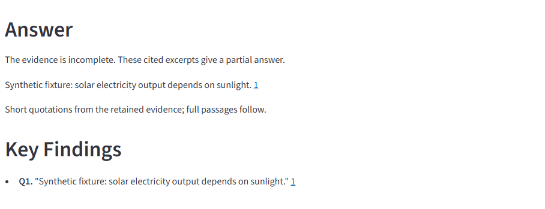

# Answer first, then key findings

**Current status:** Hosted version **2026-10-16.2** is verified after the owner
reboot. The report and downloaded Markdown show Answer before Key Findings.

## Requested presentation

The workbench report and its Markdown download show **Answer** before **Key Findings**.
The earlier reference-only Summary could make a simple answer hard to find.

The Answer section selects short, exact text from already cited and supported
quotations. For example, if the retained evidence says "Hyderabad is the capital
of Telangana.", that sentence can appear first with its source citation. Full
quotations, source links, saved passages and downloads remain available below.

## Evidence boundaries

- Answer excerpts are contiguous spans of an audited quotation. They do not add
  facts, paraphrase the source, rewrite canonical claims or make model/search calls.
- Lexical ranking favors relevant, concise sentences and excludes common social
  metadata, question-only text, markup and incomplete pronoun-led fragments.
- Scope qualifiers stay with their whole short quotation; otherwise that excerpt
  is omitted. Relevant unresolved differences prevent choosing a single winner.
- Partial research is labeled as a partial answer. If no concise supported excerpt
  is found, the report says so and shows the findings and unresolved criteria.
- This bounded presentation is not general semantic understanding or independent
  source-truth verification. Original claim records and audits remain inspectable.

The app presentation and its Markdown download opt in to the new layout. Default
legacy/CLI rendering remains compatible. Existing saved compatible workbench runs
can display the new layout without new provider calls.

## Verification

Offline regressions cover both capital-statement word orders, noisy preceding
source text, source-number mapping, exact offsets, qualifier/decimal preservation,
relevant disagreement, unrelated differences and uncited evidence. Existing
report, source-download and UI tests are included in the focused checks.

The hosted build marker is **App version: 2026-10-16.2**. Full CI and hosted checks
are recorded below. Hosting remains free only.

## Measured verification

- The first focused run passed 40 tests in 312.35 seconds. After the final caution/typing fixes, all seven answer-focused cases passed in 63.38 seconds. Together these cover 41 unique focused tests (six cases overlap).
- Source commit 11e6f4c passed [full CI](https://github.com/cakhiltej9001-source/evidenceforge-ai/actions/runs/38856496552): **554 tests in 47.47 seconds**, strict checking of 89 source files, lint/format, packaging and constrained container checks.
- The new cases include preserving an explicit false-statement caution with its quotation rather than displaying the preceding sentence alone. They check exact spans, source-number mapping and unchanged canonical state.
- The public preflight did not observe version 2026-10-16.2 and submitted no research or demonstration request. No new Gemini or Tavily calls ran for this repair.
- The browser management connection timed out during the initial preflight. The owner then rebooted the app; the check below closes that activation item.

## Hosted verification after reboot

A fresh anonymous browser observed version **2026-10-16.2** and explicitly selected
**Synthetic demonstration**. Offline reasoning was checked before submission and
live-source controls were absent. The rendered report showed a short cited Answer
before Key Findings; the actual Markdown download had the same order and contained
answer text rather than only quotation references. Saved-source viewing and its
plain-text download also passed, preserving the original URL metadata.

The fixture report correctly labels its evidence as incomplete and its answer as
partial. This check verifies hosted presentation and downloads; it is not a new
live Gemini/Tavily research test or independent verification of source truth.
**Zero Gemini calls and zero Tavily searches** were used.

See the [sanitized measured result](ANSWER_FIRST_HOSTED_2026-10-16.json).
