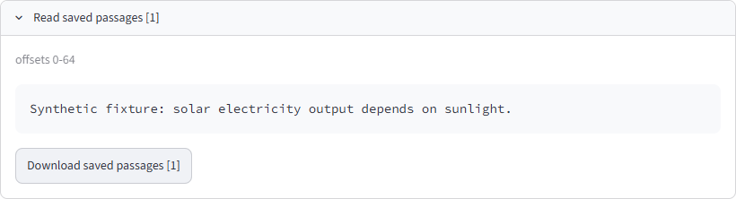

# Read saved source passages when an original website is blocked

**Hosted status: verified after owner reboot.** Version 2026-10-16.1, saved-source
links and exact text downloads are active. Pre-reboot notes below are historical.

## Diagnosis

The reported URL, https://www.globalelectricity.org/solar-vs-wind-energy/,
returned HTTP 403 to direct requests. The ordinary non-www variant returned 403
too. This is an access response from the publisher's site; changing the link text
cannot remove it. A search provider may retain text even when browser access is
blocked. Access can vary between clients.

## App change

- Source titles and citation numbers inside the app open **Saved source passages**.
- A separate **Original website** link preserves the original citation URL.
- The viewer reads only evidence cited by the final report, from its already
  owner-scoped state. It fetches no website and makes no model/search calls.
- **Download saved passages [n]** exports the exact cited text, original URL,
  provider, acquisition times, retained content scope and passage locators.
- Search/section excerpts are labeled. Retained passages are not represented as a
  complete article, current website access or independent proof of source truth.
- Downloaded Markdown keeps original URLs and explains the saved-evidence fallback;
  JSON and text downloads retain the inspected passage text.

The change also applies when reopening an existing compatible saved run. It does
not replace sources with unrelated working URLs or bypass the publisher's access
controls. No fresh Gemini or Tavily allowance is needed to read existing evidence.

## Deployment

The hosted build marker is **App version: 2026-10-16.1**. Source and UI regressions
run with networking blocked, including exact Unicode/markup preservation, exclusion
of uncited evidence, safe title rendering, local anchors and real text downloads.
Full CI and hosted activation are recorded after verification; the publisher's
original 403 response remains outside the app's control. Hosting remains free only.

## Measured verification

- 34 focused offline regressions passed in 337.52 seconds on Windows.
- Source commit 669d3fe passed [full CI](https://github.com/cakhiltej9001-source/evidenceforge-ai/actions/runs/38839597945): **547 tests in 44.24 seconds**, strict checking of 88 source files, lint/format, packaging and constrained container checks.
- Direct checks of the reported www and non-www publisher URLs both returned 403. No alternate URL was substituted into the source provenance.
- The public build preflight did not observe 2026-10-16.1 and submitted no demonstration or research request. Gemini and Tavily use for this repair is zero.
- The browser management tool timed out. An owner reboot was requested; hosted activation and a zero-provider-call synthetic UI/download check remain pending.

## Hosted verification after reboot

A fresh anonymous browser observed build 2026-10-16.1. It explicitly selected
Synthetic demonstration, verified Offline reasoning and the absence of live-source
controls, then created and approved one offline fixture plan. The rendered report
provided local citation links, labeled retained passages and a working plain-text
download containing the saved passage and original source URL. No Gemini or Tavily
calls ran. This is a UI/mechanics check with synthetic text, not a new live research
answer or a claim that the publisher has removed its 403 response.

The first after-reboot check stopped before submitting a plan because the styled
select control did not expose its value as inner text. The successful check
inspected the visible select value in its rendered container before submission.
No production source was fetched or substituted by either check.

[Machine-readable hosted result](BLOCKED_SOURCE_HOSTED_2026-10-16.json).
The screenshot is an actual public-app capture; its passage is explicitly synthetic.
The original website remains a separate external link and can still refuse access.
