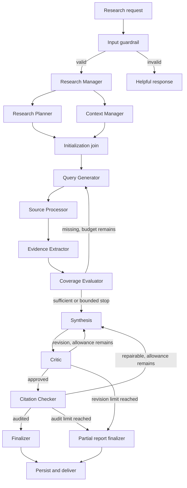

# EvidenceForge AI - Complete Codex Project Handoff

Prepared for Akhil Tej | 30 September 2026 | Specification version 1.0

**Project:** An evidence-first autonomous research system built with Python and LangGraph.

**Working name:** EvidenceForge AI. This is a proposed name, not a registered or uniqueness-verified brand.

**Positioning:** Plan, retrieve, verify, challenge, synthesize, and audit.

**Current status:** Planning only. This package contains the original assignment PDF, this engineering handoff, a proposed repository-level `AGENTS.md`, and setup instructions. No application, tests, benchmarks, deployment, or API integration has been implemented or validated yet.

## Contents

1. Project goal and source authority
2. PDF summary and requirement traceability
3. Scope and enhancement priorities
4. Technology stack and dependency policy
5. Architecture and graph routing
6. Agent and component responsibilities
7. Shared state and validated schemas
8. Retrieval and private-document RAG
9. Evidence extraction and selective storage
10. Evidence graph and claim mapping
11. Source quality ranking
12. Contradiction-aware research
13. Coverage evaluation and research modes
14. Citation verification and output contract
15. Budgets, cost, and latency
16. Persistence, memory, and human control
17. Security and tool boundaries
18. Observability and error handling
19. Backend, frontend, exports, and deployment
20. Evaluation framework
21. Testing and repository architecture
22. Implementation milestones
23. Exact Codex prompts for every phase
24. Competition demonstration strategy
25. Assumptions, risks, and official references

## 1. Project goal and source authority

Akhil wants to understand and build the AI Research Agent course project with Codex, learn the engineering along the way, and extend the assignment into a distinctive competition submission. Aim for a strong demonstration and defensible measured results; a first prize cannot be guaranteed, and the judging rubric and deadline have not been supplied.

The application accepts a research question, creates a plan, gathers evidence from multiple sources, identifies unanswered questions, performs bounded follow-up research, writes a cited report, critiques it, and audits its factual claims. A reader should be able to inspect the evidence supporting each finding and see disagreements and limitations.

Use these sources in this order:

1. The user's latest explicit instructions govern scope and choices.
2. `docs/requirements/AI Research Agent.pdf` supplies the original assignment baseline.
3. This handoff translates that baseline into implementation contracts and labels additional design choices.
4. `AGENTS.md` supplies concise working conventions.
5. Official documentation and installed package APIs determine implementation details.

The prior discussion contained exploratory alternatives. This handoff preserves the useful decisions while resolving implementation gaps. It is not a verbatim transcript. Treat proposals, example budgets, schema sketches, and future features as designs, not completed capabilities.

**First Codex task:** Read the package, inspect the target repository, and create `docs/IMPLEMENTATION_PLAN.md`. Do not implement the full application or assume an empty repository.

## 2. PDF summary and requirement traceability

The supplied PDF has 23 pages. Page numbers below are physical PDF page numbers. It is a conceptual implementation guide rather than a formal grading rubric. Its ten roles can be graph nodes, while parsing, hashing, validation, and budget checks can be ordinary Python functions.

The four central ideas are autonomous planning, multi-source retrieval, a self-evaluation research loop, and grounded cited output. State and conditional transitions make the system meaningfully agentic.

| ID | Requirement or guidance from the PDF | Pages | Implementation evidence |
|---|---|---:|---|
| B01 | Decompose a research question into focused subquestions | 2, 6, 8-9 | Structured plan with stable question IDs |
| B02 | Provide web, private-document, and API/MCP retrieval paths | 2, 5-6, 10 | Web and document adapters; documented external integration interface |
| B03 | Research Manager coordinates Planner and Context Manager initialization | 5, 8-9 | Two initialization branches and a join before query generation |
| B04 | Generate queries appropriate to each source | 9-10 | Query records linked to subquestions and source types |
| B05 | Extract relevant passages, score relevance, deduplicate, retain provenance | 10-11 | Normalized evidence records and rejection reasons |
| B06 | Use shared `ResearchState` and deliberate reducer semantics | 7-8 | Typed state, partial updates, reducer tests |
| B07 | Evaluate coverage; missing evidence causes new targeted queries | 11-12, 15 | Conditional research edge exercised by a test |
| B08 | Stop research at a configured iteration limit and disclose incomplete coverage | 12, 20 | Bounded termination and partial-result report |
| B09 | Produce Markdown with Summary, Key Findings, and Sources | 13 | Report schema and rendered Markdown |
| B10 | Critic checks coherence, grounding, and completeness; requests revision | 13-16 | Structured verdict and bounded rewrite route |
| B11 | Citation Checker traces factual claims to retrieved evidence and references | 14 | Claim audit with evidence IDs and support judgments |
| B12 | Register, connect, and compile LangGraph nodes and edges | 14-16 | Executable compiled `StateGraph` and graph visualization |
| B13 | SQLite checkpoints and `thread_id` provide persistent workflow state | 16, 23 | Resume and isolation tests across process restarts |
| P01 | Protect secrets with environment variables and ignored `.env` | 3-4 | Empty `.env.example`; secrets excluded from source and logs |
| P02 | Reject invalid, vague, out-of-scope, or manipulative research inputs | 19 | Input validation and helpful failure responses |
| P03 | Observe prompts, tools, routing, latency, and token usage | 20 | Traces plus explicit application events and metrics |
| P04 | Surface tool failures and support ordered provider fallback | 21 | Structured errors and tested retry/fallback behavior |
| P05 | Filter stored evidence and cap size; persist selected research summaries | 21 | Bounded evidence selection and a separate report repository |
| P06 | Give each phase only the tools it needs | 22 | Phase-specific capabilities and read-only retrieval |

PDF stack guidance: `langgraph`, Tavily integration/client, one provider-specific LangChain package, `python-dotenv`, `pypdf`, `python-docx`, and `langgraph-checkpoint-sqlite` (pages 3-4). The provider choices include OpenAI, Google Gemini, Anthropic, and Groq. Search providers are replaceable.

Important interpretations to document:

- Pages 5 and 8 show parallel initialization; both branches must finish before query generation. Page 17 presents those operations sequentially for explanation. Use explicit join semantics.
- The diagram places retrieval boxes before Source Processor, while prose calls Source Processor the dispatcher. Model it as the adapter orchestration boundary; avoid executing retrieval twice.
- API/MCP is described as an extensibility point. Deliver an adapter contract and fixture initially; make one live specialized adapter a later milestone. Confirm if the instructor requires a live MCP connection.
- The sample walkthrough contains duplicated steps and calls query generation a Planner step once. Use the role definitions and routing description as the coherent baseline.
- The PDF's critic and citation-checking descriptions are goals, not guarantees of factual correctness. Self-review by an LLM needs independent evaluation.
- Workflow checkpoints do not automatically become a searchable cross-session knowledge base. Build explicit summary retrieval and permission scoping.

## 3. Scope and enhancement priorities

Finish the baseline end-to-end before expanding the UI or adding many specialized agents.

| Priority | Deliverable | Reason |
|---|---|---|
| Required baseline | Ten core roles, shared state, retrieval, coverage loop, critic, citations, persistence, Markdown report | Assignment fidelity |
| Reliability foundation | Bounded loops, typed outputs, budgets, structured errors, provenance, least-privilege tools | Makes the baseline safe to demonstrate |
| Standout A | Claim-to-evidence graph with inspectable passages | Shows why a finding is supported |
| Standout A | Contradiction detection and targeted counter-evidence retrieval | Exposes disagreement rather than hiding it |
| Standout A | Reproducible evaluation against simple baselines | Provides evidence that enhancements help |
| Standout B | Per-question coverage matrix and live event timeline | Makes agent behavior visible |
| Standout B | Private PDF and web comparison, source ranking, budget dashboard | Useful research product behavior |
| Later | Quick/Deep/Academic modes, plan approval, Markdown/JSON/PDF export | Product completeness |
| Stretch | Specialized API/MCP adapter, multilingual reports, advanced long-term memory | Add when time and evidence justify them |

Explicitly defer autonomous browsing with write access, arbitrary code execution, large connector catalogs, multiple vector databases, and an elaborate frontend before the graph works. Each enhancement must have a visible use case and an acceptance check.

## 4. Technology stack and dependency policy

These are design recommendations, not claims about free tiers or installed versions. Start with one model provider, one search provider, and local persistence.

| Layer | Initial choice | Later choice or alternative | Purpose |
|---|---|---|---|
| Runtime | Python 3.11+ | Select a supported version after compatibility check | AI application and backend |
| Coding workflow | Codex in the project repository | CLI or IDE interface available to the user | Implement, review, explain, and test |
| Orchestration | LangGraph `StateGraph` | Preserve LangGraph as the course foundation | State, conditional edges, loops |
| Model boundary | LangChain core and one provider package | Additional provider adapters | Structured planning and synthesis |
| Default provider proposal | Gemini, if Akhil chooses it | OpenAI, Anthropic, or Groq | Configurable LLM calls |
| Web | Tavily official Python client | Configured second search provider | Live evidence retrieval |
| Documents | `pypdf`, `python-docx`, TXT reader | OCR only if required | Text with document/page provenance |
| Initial document search | Lexical/BM25-style retrieval | Hybrid lexical and vector retrieval | A simple reproducible document baseline |
| Chunking | LangChain text splitters or a small explicit splitter | Token-aware splitter | Preserve manageable passages |
| Embeddings | Defer until baseline document retrieval works | One local or API embedding model | Semantic document matching |
| Vector store | None initially | Qdrant local/server OR PostgreSQL with pgvector | Semantic index; choose one |
| Validation | Pydantic | TypedDict for shared graph state | Validate external and model outputs |
| Checkpoints | SQLite LangGraph checkpointer | PostgreSQL-compatible checkpointer | Workflow resume |
| Report/evidence repository | SQLite | PostgreSQL | Searchable summaries and audit records |
| HTTP/concurrency | `httpx`, `asyncio` | Bounded background workers | Timeouts and concurrent retrieval |
| API | CLI first; FastAPI later | Authentication when deployed | Backend boundary |
| UI | Streamlit | Next.js/React only if justified | Usable demo; polished final UI |
| Tracing | LangSmith, explicitly configurable | Langfuse if self-hosting is needed | Observe execution |
| Tests/checks | pytest, Ruff, a type checker | CI with GitHub Actions | Verify contracts and failure behavior |
| Packaging | `pyproject.toml` and a tested lockfile | Docker after working milestones | Reproducibility |
| Hosting | Decide after demo works | Render/Railway-style backend; Vercel-style frontend | Verify current limits before selection |

Do not install every provider integration or infrastructure option. Dependency groups should distinguish `core`, one selected model provider, `documents`, `ui`, `api`, and `dev` where useful. Resolve and pin a compatible set at implementation time. Use current official documentation and a smoke test to validate imports, async behavior, checkpoint lifecycle, and structured-output support.

The same conceptually named API key may require different SDK environment names. Map application-level settings to the chosen adapter explicitly. Do not invent model IDs or assume access/free quota. Missing live credentials should produce a clear setup message; fixture mode must be labeled.

## 5. Architecture and graph routing

Keep UI and API outside graph logic. Nodes receive typed state and return partial updates. Dependencies such as clients and repositories are injected at graph construction/runtime, not stored in serializable state.

### Baseline topology



The citation repair route and bounded quality-failure finalizer are additional engineering choices. They close failure paths that the conceptual PDF leaves unspecified. Empty evidence produces an insufficient-evidence report, never an invented answer.

### Routing contract

| From | Condition | Destination |
|---|---|---|
| Guardrail | Invalid or needs clarification | Terminal helpful response |
| Manager | Valid | Planner and Context Manager in parallel |
| Both initialization branches | Both done | Query Generator, once |
| Query Generator | Queries within budgets | Source Processor |
| Source Processor | Results/errors collected | Evidence Extractor |
| Evidence Extractor | Normalized evidence ready | Coverage Evaluator |
| Coverage | Missing + remaining passes/searches/time | Query Generator with explicit gaps |
| Coverage | Sufficient | Synthesis |
| Coverage | Exhausted allowance or no useful new evidence | Synthesis with limitations |
| Synthesis | Draft produced | Critic |
| Critic | Revision + remaining rewrite budget | Synthesis with revision brief |
| Critic | Approved | Citation Checker |
| Citation Checker | Unsupported/incorrect attribution and allowance remains | Synthesis repair, then Critic again |
| Quality stage | Rewrite budget exhausted | Partial/insufficient output with audit findings |
| Citation Checker | Audit complete | Finalizer, then persistence and end |

Use a multi-source join such as `add_edge(["planner", "context_manager"], "query_generator")` when supported by the selected version. If a separate join node is used, its semantics must still wait for both predecessors. Parallel branches should write separate keys or use explicit merge reducers.

Optional enrichment happens after extraction and before coverage: source ranking, claim/evidence linking, and contradiction analysis. A new dispute can become a research gap, but it cannot reset budgets. Deterministic services do not need their own LLM agents.

## 6. Agent and component responsibilities

| Component | Inputs | Outputs | LLM needed? |
|---|---|---|---|
| Input Guardrail | Query and limits | Accepted/clarification/rejected with reason | Optional lightweight classifier after deterministic validation |
| Research Manager | Valid request/settings | Run initialization and intent | Optional; use a model only for useful interpretation |
| Research Planner | Question, preferences | Atomic subquestions and plan | Yes |
| Context Manager | Owner scope, document IDs, prior summaries | Accessible context references | Mostly repository/search code |
| Query Generator | Plan, context, gaps, attempted queries | Source-specific query records | Yes |
| Source Processor | Queries and budget reservations | Normalized raw results and tool errors | Mostly deterministic async dispatch |
| Evidence Extractor | Raw results and questions | Relevant grounded passages and rejection log | Hybrid; model extraction with exact-span validation |
| Coverage Evaluator | Questions, evidence, unresolved disputes | Per-question status, gaps, verdict | Hybrid rules and structured LLM assessment |
| Synthesis | Admitted evidence and gaps | Structured claims and Markdown draft | Yes |
| Critic | Draft, evidence, plan | Verdict and concrete revision brief | Yes |
| Citation Checker | Claims and source records | Structural checks and support audit | Deterministic IDs plus semantic support evaluator |
| Finalizer | Audit and budget status | Honest final report and run status | Mostly deterministic |
| Budget service | Planned and completed calls | Reservations, counters, stop reasons | No |
| Credibility service | Source metadata | Ranking features and rationale | Rules first; model judgment optional |
| Contradiction service | Comparable claims/evidence | Dispute records or uncertainty | Hybrid normalization and semantic review |
| Evidence graph service | Claims, evidence, sources | Nodes and typed edges | No for graph construction |

A node is a workflow step, not necessarily a separate model or autonomous assistant. More agents are not a success metric.

## 7. Shared state and validated schemas

The PDF baseline fields are `messages`, `research_questions`, `evidence_store`, `coverage_status`, `final_report`, and `iteration_count`. Preserve their conceptual roles while strengthening types.

Use a `TypedDict` for graph state, Pydantic models for incoming requests, structured LLM outputs, evidence, and API contracts. Define enum/literal values rather than free-form routing strings. Serialize models consistently for checkpoint storage.

| State group | Fields | Meaning |
|---|---|---|
| Identity | `run_id`, `thread_id`, `owner_scope`, `schema_version` | Run identity, persistence key, access boundary |
| Request | `original_question`, `user_preferences`, `mode`, `language`, `report_format` | What the user requested |
| Planning | `research_questions`, `plan_version`, `context_refs`, `plan_approval_status` | Structured plan and available context |
| Queries | `search_queries`, `attempted_query_keys` | Pending queries and repeat prevention |
| Sources | `source_records`, `raw_result_refs` | Source provenance and raw artifact pointers |
| Evidence | `evidence_store`, `rejected_evidence`, `source_quality` | Accepted passage records and decisions |
| Coverage | `coverage_by_question`, `coverage_status`, `gaps` | Adequacy and follow-up needs |
| Disputes | `contradictions`, `claim_evidence_map` | Supported, disputed, and unresolved propositions |
| Report | `draft_report`, `report_claims`, `critic_verdict`, `revision_brief`, `citation_audit`, `final_report` | Quality pipeline |
| Control | `iteration_count`, `revision_count`, `stop_reason`, `run_status` | Bounded execution and terminal state |
| Budget/metrics | `budget`, `usage`, `started_at`, `finished_at` | Call, token, time, and estimated cost accounting |
| Events/errors | `messages`, `events`, `tool_errors` | Bounded diagnostic history |

Proposed small schema records:

- **ResearchQuestion:** stable ID, question, importance weight, acceptance criteria.
- **SearchQuery:** ID, subquestion IDs, text, source type, research pass, purpose (`support`, `counter_evidence`, or `primary_source`).
- **SourceRecord:** ID, title, URL or document ID, provider, publisher, retrieved time, publication date if known, content hash, access status, trust-boundary metadata.
- **EvidenceItem:** ID, source ID, exact passage, page/section/offset locator, related question IDs, query ID, relevance score/rationale, retrieval time, ranking features, admission status.
- **ResearchGap:** question ID, missing aspect, needed evidence type, recommended follow-up, priority.
- **Claim:** ID, atomic statement, report location, claim kind (`fact`, `inference`, or `recommendation`), scope/time qualifiers.
- **ClaimEvidenceLink:** claim ID, evidence ID, relationship (`supports`, `contradicts`, `context`, `uncertain`), rationale and verifier provenance.
- **Contradiction:** ID, comparable proposition, evidence IDs on each side, date/scope differences, unresolved/resolved status, follow-up query.
- **CitationAuditItem:** claim ID, referenced evidence IDs, structural validity, semantic support verdict, omissions, repair action.
- **ToolError:** provider, query ID, category, retryability, attempt, sanitized message.
- **UsageRecord:** call ID, provider/model, tokens if reported, latency, search credits if reported, price-table version, estimated cost or unknown.

Reducer rules:

1. Append-only events must have event IDs so retries can be deduplicated.
2. Evidence/source collections should merge by stable ID rather than blindly append. Preserve multiple provenances for repeated content.
3. Pending queries, coverage verdict, draft, and revision brief overwrite their old values.
4. Parallel initialization writes distinct fields. Do not let both branches overwrite one shared scalar.
5. Metrics merge idempotently by call ID. Retrying a checkpointed node must not count the same completed call twice.
6. Keep large raw pages in an artifact repository; use references in checkpoints. Bound state history and retained evidence.

`iteration_count` means completed retrieval passes. Start at zero; increment exactly once when a retrieval pass finishes. `max_research_passes=3` means at most three passes total. Graph supersteps/recursion limits are a separate safety backstop.

## 8. Retrieval and private-document RAG

Define one provider-independent interface, conceptually `async retrieve(query, limits, scope) -> RetrievalBatch`. Every batch contains results plus structured errors. Each result uses a common provenance schema.

Implement in order:

1. Fixture adapter for deterministic offline tests and demo replay.
2. Tavily web adapter with bounded concurrency, timeout, cancellation, and explicit search options.
3. PDF/DOCX/TXT ingestion and lexical retrieval with page/paragraph locators.
4. One embedding model and one vector store when semantic recall is needed.
5. One specialized read-only API adapter, then MCP if it adds useful access.

Private-document path: validate file size/type; hash and register document; parse text with page/paragraph locations; chunk with modest overlap; index with owner/document filters; retrieve candidates; rerank for the subquestion; preserve locators in citations. Detect textless/scanned PDFs and disclose OCR as unavailable until implemented. Embedded documents can still contain malicious instructions.

Prefer hybrid retrieval only after a lexical baseline exists. Tune chunk size, overlap, top-k, and relevance thresholds on held-out questions. Do not hard-code settings as universally optimal.

API/MCP records retain query parameters and response fields used as evidence. Configure allowed endpoints/tools; validate schemas; set timeouts and source credentials server-side. A fixture adapter proves the contract, not a live integration. Label it accordingly.

Fallback providers must be explicitly configured and have compatible content/permission policies. A network failure should not send private document text to an unexpected provider. Retrieval uses original questions and minimal necessary excerpts; document contents are not automatically included in public web queries.

## 9. Evidence extraction and selective storage

Normalize URLs safely, hash content, score relevance, and retain the passage supporting the extracted finding. A model-generated paraphrase is not itself evidence. Check exact passages against raw content; OCR/normalization changes require a documented locator strategy.

Deduplicate identical chunks while preserving all source/query links. Near-duplicate publications should be marked as a source family; syndicated copies are not independent corroboration. Avoid evicting the only evidence for a required subquestion simply because another topic has more high-scoring passages.

Admission rules consider relevance, available provenance, content quality, and security flags. Rejection records retain reason codes such as `irrelevant`, `duplicate`, `no_locator`, `parse_failed`, or `suspected_instruction_attack`.

Selective storage caps evidence count and bytes. Once drafting starts, cited evidence is pinned until the audit finishes. Never produce orphaned citations by evicting supporting passages.

## 10. Evidence graph and claim mapping

This is the primary visible differentiator. Implement a graph projection from authoritative records; a graph database is not initially required.

**Nodes:** research question, report claim, evidence passage, source. **Edges:** addresses, supports, contradicts, contextualizes, retrieved-from, duplicate-of.

Click a claim to see its exact passages, source URLs/document pages, support judgments, disputes, and unresolved gaps. Include an accessible table alternative. Limit the default view to the selected finding so the graph remains readable.

Example, explicitly illustrative: a claim about retrieval helping with frequently changing knowledge links to two passages and one caveat. The UI should display the source scope and assumptions instead of simply counting votes.

Acceptance: every link resolves to a stored record; invented source IDs fail validation; clicking a graph edge opens the recorded passage; contradictory edges stay visible in the exported audit.

## 11. Source quality ranking

Use an explainable ranking heuristic, not a probability that a source is true. Authority and relevance are different. Official documentation may be best for an API contract and less independent for comparing competing products.

Consider relevance, primary evidence, publisher/author identity, methodological transparency, topic-dependent recency, independent corroboration, and source-family duplication. Missing metadata means unknown, not automatically trustworthy or untrustworthy.

A proposed ranking function is a weighted combination of normalized features with topic-specific weights and an explicit version. Avoid blindly multiplying arbitrary scores: one missing date could otherwise collapse the score, and correlated features could count the same evidence repeatedly.

Recency should matter strongly for current API behavior or prices and less for historical facts. A government or academic domain is a signal, not a truth guarantee. Store feature values and rationale and let users inspect them.

Acceptance: explain rankings, show unknown features, and demonstrate a case where a recent secondary article does not outrank the relevant primary source merely because it is newer. Evaluate ranking changes on source relevance judgments.

## 12. Contradiction-aware research

Normalize propositions with entity, metric, timeframe, population, conditions, and units. Different dates or definitions may explain apparent disagreement; absence of support does not imply contradiction.

Proposed process:

1. Extract atomic propositions tied to exact evidence spans.
2. Group comparable propositions.
3. Classify support, contradiction, or insufficient comparison with rationale.
4. Check numeric differences deterministically where possible.
5. Queue targeted primary-source and counter-evidence queries within the existing budget.
6. Report disagreement, resolution, and remaining uncertainty.

Do not instruct the system to manufacture an opposing view when evidence is consistent. Do not treat three copied articles as three independent votes.

Acceptance fixtures include a real disagreement, an apparent disagreement resolved by publication dates, different units, and unrelated claims that must not be labeled contradictory. Counter-evidence queries should improve measured dispute handling.

## 13. Coverage evaluation and research modes

Evaluate each subquestion against explicit acceptance criteria. Return `missing`, `partial`, `sufficient`, or `disputed` per question with evidence IDs and a rationale. Retain the PDF's overall `coverage_status` as `missing` or `sufficient`; control/budget state decides whether further research is permitted.

Coverage considers whether the requested aspects are addressed with usable evidence, rather than the number of retrieved pages. An optional weighted score can summarize the matrix, but label it an internal adequacy score, not factual accuracy or calibrated confidence.

| Mode | Proposed passes | Proposed searches | Output strategy |
|---|---:|---:|---|
| Quick | 1 | Up to 4 | Short findings and explicit gaps |
| Deep | Up to 3 | Up to 12 | Full audit and contradiction follow-up |
| Academic | Up to 3 | Up to 12 | Prefer papers/primary datasets, publication metadata and DOI when available |

These budgets are initial defaults, not measured requirements. Academic routing is about source selection, not a claim that all results are peer reviewed. Configure and tune against cost and evaluation results.

Stop on maximum passes, searches, elapsed time, insufficient remaining synthesis allowance, cancellation, or repeated no-progress. Report the stop reason. Do not set coverage to sufficient merely to terminate.

## 14. Citation verification and output contract

Generate structured claims with evidence IDs first, then render Markdown. The renderer should create references from stored metadata; the LLM must not invent URLs.

Separate checks:

- **Structural validity:** every cited ID exists and resolves to a source/locator.
- **Semantic support:** the cited passage actually supports the specific statement, including numeric, date, and scope qualifiers.
- **Completeness:** factual statements throughout the Summary and Key Findings are covered, including uncited statements.
- **Attribution accuracy:** support is assigned to the correct source; inference combines evidence transparently.

URL reachability alone is not factual verification. LLM entailment judgments are fallible and must be checked against human-labeled examples. Recommendations and inferences should be labeled rather than converted into unsupported facts.

Preserve the PDF report sections: **Summary** (normally 2-3 concise paragraphs when evidence permits), **Key Findings**, and **Sources**. Add **Disagreements**, **Research Limitations**, **Coverage**, and **Citation Audit** when useful. A no-evidence report can be shorter and should explain the inability to answer.

Source entries contain title, URL or private-document locator, retrieval date, and evidence IDs/passages used. Use short excerpts and respect provider/source permissions; private sources remain private.

Terminal statuses: `completed` for an audited result meeting criteria; `partial` for bounded incomplete evidence or unresolved issues; `insufficient_evidence` for no defensible answer; `failed` for a fatal infrastructure failure; `cancelled` for user cancellation. No status should silently equate traceability with truth.

## 15. Budgets, cost, and latency

Track searches, model calls, input/output tokens when reported, evidence bytes, elapsed time, completed passes, and rewrites. Reserve capacity before concurrent calls to prevent races. Reserve enough allowance to synthesize and audit the gathered evidence.

Cost is an estimate computed from recorded usage and a dated configurable price table. Include search credits and embedding calls if their accounting is available. Cached/unknown usage must be labeled; never show zero cost because usage metadata is missing. No current prices or free quotas are assumed in this handoff.

Wall-clock limits, token limits, and spend estimates are separate controls. A spend controller cannot promise an exact financial hard cap when pricing or in-flight usage is uncertain. Bound concurrency and call lengths and use conservative reservations.

User-visible metrics: duration, searches, sources, accepted passages, research passes, citation audit counts, unresolved gaps, estimated cost, and unknown-cost calls.

## 16. Persistence, memory, and human control

Use a checkpointer for thread state/resume; use a separate repository for final reports, evidence metadata, and searchable prior summaries. A new run should not inherit stale counters, drafts, or approval decisions.

All memory retrieval must be filtered by owner scope and permission. Reuse reports as navigation/context, then inspect their underlying evidence. Prior generated text is not an independent primary source. Revalidate time-sensitive facts; retain retrieval/publication dates and TTL rules.

For Deep mode, offer plan approval/edit/cancel through a LangGraph interrupt after the initialization join. Store a plan version and resume payload; validate edited plans and budgets. A UI button alone is not workflow interruption.

Resumed nodes can re-execute code preceding an interrupt. Keep that code side-effect free or idempotent and place approval before paid retrieval. Test one-time execution and correct thread ownership. Provide deletion controls when user data is persisted.

## 17. Security and tool boundaries

Treat user documents, web pages, source titles, API payloads, and MCP outputs as untrusted data. Keep retrieved content separated from system instructions and constrain model outputs to validated records.

Prompt-injection defenses include least privilege, read-only retrieval, strict schemas, endpoint/tool allowlists, no secrets in model context, sanitized rendering, and adversarial fixtures. A keyword detector or content sanitizer alone does not make injection impossible. Do not silently remove adversarial material if it is relevant evidence; label/quarantine it under a defined policy.

Planning and evaluation have no external tools. Retrieval has only approved read tools. Synthesis has evidence lookup. The application has no arbitrary shell or code execution capability.

For deployed URL fetches, restrict schemes and prevent requests to private/loopback/link-local/metadata endpoints, including redirects and DNS resolution changes. Validate upload types/sizes and sanitize paths. Escape HTML in reports; do not render arbitrary source HTML. Public deployments need authorization on run/document/event/export endpoints and rate limits.

Private documents must not leak into traces, browser events, or external search requests. Cloud model processing and tracing have explicit configurable data policies. This is engineering scope for this research application, not a claim of certified security.

## 18. Observability and error handling

Use LangSmith for supported model/tool traces; add application instrumentation for custom adapters, deterministic routing, budget actions, and event streams. Verify actual recorded coverage rather than assuming two environment variables observe every custom function.

Event examples: plan created, retrieval started/completed, evidence admitted/rejected, gap found, research loop, contradiction found, draft created, critic revision, citation audit, budget stop, final status. Events expose decisions and evidence metadata, not hidden chain-of-thought.

Retry transient failures with bounded exponential backoff and jitter. Honor rate-limit guidance when available. Do not retry authentication errors without a configuration change. Capture expected provider/parse/schema errors; unexpected programming bugs should remain diagnosable, not be relabeled as successful research.

If one retrieval channel fails, continue with other permitted evidence and disclose the gap. If the model fails, return a failed or partial status with preserved evidence; do not substitute an unreviewed fabricated report. Fixture replay is a labeled demo option, not an invisible live fallback.

Acceptance: trace a loop, a tool failure, a rewrite, a budget stop, and the final audit. Redact keys and private text. Use call/event IDs to avoid duplicate records on resume.

## 19. Backend, frontend, exports, and deployment

Begin with a CLI, then a Streamlit demo using the same application service. Add FastAPI when the graph and reports are stable. A later Next.js frontend is optional, not necessary for a strong entry.

Proposed API contracts:

| Endpoint | Behavior |
|---|---|
| `POST /research` | Validate request, create run, return run ID |
| `GET /research/{id}` | Return status, plan, metrics, safe result metadata |
| `GET /research/{id}/events` | Stream sanitized events, support reconnect IDs |
| `POST /research/{id}/plan` | Approve/edit/cancel a paused plan |
| `POST /research/{id}/cancel` | Cooperatively cancel in-flight work |
| `GET /research/{id}/report` | Retrieve permitted report/export |
| `POST /documents` | Validate and register permitted uploads |
| `GET /health` | Health without exposing credentials |

Use a persisted background job boundary when needed; do not keep a long graph run inside an unbounded request handler. Server-sent events are sufficient for the initial timeline. Validate ownership on every run and document request.

UI areas: question/mode/source controls; editable research plan; live timeline with coverage and budget; report with clickable evidence graph, source-quality rationale, disagreements, and citation audit. Use a polished dark green/teal theme with a restrained diamond accent if Akhil wants the visual identity discussed earlier. Accessibility and readable evidence take priority over animation.

Exports: Markdown first, JSON audit next, PDF after report layout can be rendered and checked. The JSON preserves IDs and provenance. A report and its audit should be generated from the same records.

Deployment follows local reliability: containerize, separate secrets from images, configure persistent storage and limits, protect uploaded documents, document data retention, and smoke-test run/interrupt/cancel/resume. Verify hosting support for long-running jobs, disk persistence, timeouts, and current pricing before choosing a platform. A deployed demo is not automatically production-ready.

## 20. Evaluation framework

Evaluation is the strongest way to substantiate project quality. Use 20-30 diverse questions as an initial target, with a smaller development subset and a held-out test subset. Include current/historical research, comparisons, private-document facts, unanswerable questions, disagreements, numerical qualifiers, tool failures, and injection attempts.

Compare:

1. A single LLM without retrieval, whose lack of citations is honestly recorded.
2. A fixed one-pass retrieval-and-generation baseline using matched sources/model.
3. The complete research agent with loops and audit.

Also perform ablations: remove adaptive research, remove contradiction follow-up, remove source ranking, and remove citation repair. Match budgets where possible; otherwise report the budget difference. This isolates the effect of each enhancement.

| Metric | Definition and ground truth |
|---|---|
| Citation precision | Supported cited factual claims / audited cited factual claims, using human labels |
| Citation completeness | Factual claims with adequate supporting citations / all audited factual claims |
| Groundedness | Claims supported by admitted evidence / audited factual claims |
| Required-aspect coverage | Reference answer aspects adequately addressed / required aspects |
| Unsupported-claim rate | Unsupported factual claims / audited factual claims |
| Contradiction precision/recall | Correctly identified disputes against labeled comparable disputes |
| Source diversity | Independent publisher/source families used, with topic context |
| Failure behavior | Fraction of specified adverse cases producing expected safe status |
| Latency | End-to-end measured duration; report median and tail values where sample permits |
| Usage/cost | Recorded usage and dated cost estimate with unknowns disclosed |

Use N/A when a denominator is zero. Record citation coverage separately so a no-citation answer cannot appear perfect through N/A precision. Citation presence, semantic support, and factual truth are different metrics.

Human annotation should include claim boundaries, acceptable evidence, support/contradiction labels, and reference aspects. An LLM judge may assist, but evaluate its agreement with human labels and retain judge prompts/models/versions. Mask system identities when feasible. Prevent test data from becoming research memory.

Store question ID, corpus/search snapshot, query date, model/provider, prompt version, dependency versions, budgets, raw output, audit labels, usage, and seed when available. Live-web repeats are not perfectly reproducible; a fixture/snapshot track is reproducible and a live track measures freshness.

Report sample size, exclusions, missing runs, and variation across repeated runs where affordable. Commit real results and limitations. Never populate comparison tables with invented improvements or a made-up accuracy percentage.

## 21. Testing and repository architecture

Test important behavior rather than copying implementation details. Default tests run offline; paid/live integrations are explicit opt-in smoke tests.

Essential cases: parallel initialization joins once; missing evidence triggers a targeted second pass; sufficient evidence bypasses extra searches; zero evidence ends honestly; critic revisions and citation repairs stop; nonexistent IDs fail; a valid URL with unrelated content fails support; duplicates preserve provenance; budgets cannot race; provider failures degrade clearly; private scopes stay isolated; malicious documents cannot cause tool escalation; checkpoints resume without duplicate side effects.

Proposed final layout, created incrementally:

```text
evidenceforge-ai/
  AGENTS.md
  README.md
  pyproject.toml
  .env.example
  .gitignore
  docs/
    CODEX_HANDOFF.md
    IMPLEMENTATION_PLAN.md
    PROGRESS.md
    architecture.md
    evaluation.md
    requirements/AI Research Agent.pdf
  src/evidenceforge/
    cli.py
    config.py
    schemas.py
    graph/{state,builder,routing}.py
    nodes/{manager,planner,context,queries,coverage,synthesis,critic,citations}.py
    retrieval/{base,fixtures,tavily,documents,external_api,mcp}.py
    evidence/{extraction,deduplication,ranking,contradictions,graph}.py
    services/{research,budgets,events}.py
    storage/{checkpoints,reports,documents}.py
    guardrails/{inputs,content,urls}.py
    observability/{tracing,usage}.py
    evaluation/{datasets,metrics,baselines,runner}.py
    api/{app,routes}.py
  tests/
    unit/
    integration/
    fixtures/
  evaluation/{datasets,results}/
  frontend/
  scripts/
  .github/workflows/
```

Brace paths are a compact description, not actual literal filenames. Do not create empty modules for every future feature in the first milestone. Keep generated databases, private documents, secrets, and private traces out of git. Include curated synthetic/public fixtures only.

## 22. Implementation milestones

| Phase | Deliverable | Done when |
|---|---|---|
| 0 | Requirement analysis and implementation plan | PDF mapping, graph/state design, risks, repo inspection documented |
| 1 | Foundation and schemas | Installable package, config, state contracts and reducers tested |
| 2 | Planning and context join | Atomic questions, accessible context, typed queries, one join |
| 3 | Web retrieval and evidence | Fixture plus Tavily adapter; provenance and deduplication work |
| 4 | Coverage loop and baseline report | Targeted looping, bounded critic/audit, honest partial report |
| 5 | Documents and persistence | PDF/DOCX/TXT retrieval, locators, resume and owner isolation |
| 6 | Evidence graph, ranking, contradictions | Inspectable claim links and tested dispute handling |
| 7 | Budgets, guardrails, observability | Adverse cases bounded, redacted events/traces, usage accounting |
| 8 | Human control, API, and demo UI | Approval/edit/cancel, streaming timeline, usable reports |
| 9 | Evaluation and ablations | Held-out benchmark and honest comparison artifacts |
| 10 | Optional external adapter and deployment | Useful live integration, reproducible setup, deployment smoke checks |
| 11 | Submission package | README, demo, diagrams, results, limitations, clean repository |

Reliability controls are introduced as soon as the relevant feature appears: do not wait until Phase 7 to bound a loop introduced in Phase 4. Phase 7 consolidates and tests them. Deadline, budget, and rubric are unknown; use milestone gates instead of invented delivery dates.

Maintain `docs/PROGRESS.md`: current phase, implemented behavior, exact checks/results, known gaps, and next action. Do not mark optional features complete because their interfaces exist.

## 23. Exact Codex prompts for every phase

Use one phase prompt at a time. Each prompt authorizes its listed work; stop at that milestone and explain it. Continue fixing failures within that phase without repeatedly asking permission for routine reversible edits.

### First prompt: Phase 0

```text
Act as my senior AI engineering mentor for EvidenceForge AI.
Read AGENTS.md, docs/CODEX_HANDOFF.md, and
docs/requirements/AI Research Agent.pdf completely.
Inspect the existing repository and preserve useful work.
Do Phase 0 only: create docs/IMPLEMENTATION_PLAN.md and docs/PROGRESS.md.
Map baseline requirements to PDF pages and proposed files.
Identify the ten core roles, state fields, reducers, parallel initialization join,
fixed/conditional edges, research loop, critic loop, citation repair, and all
termination conditions. Separate required behavior from proposed enhancements.
Check current official documentation before selecting dependency APIs/versions.
List assumptions, open rubric questions, technical risks, and milestone gates.
Do not implement application code or deploy anything.
Explain the plan in beginner-friendly language and recommend Phase 1 only.
```

### Phase 1: Foundation and shared state

```text
Read the handoff, implementation plan, and progress file. Implement Phase 1 only.
Create a minimal Python package, pyproject.toml, .env.example, .gitignore,
configuration loader, validated schemas, shared ResearchState, and relevant tests.
Preserve existing repository instructions; merge additions rather than overwrite.
Implement source/evidence/query/claim/gap/audit/error/budget records and deliberate
merge/overwrite semantics. Use stable IDs and serializable checkpoint data.
Do not implement research nodes, live calls, UI, or vector infrastructure yet.
Resolve a compatible dependency set and record it; do not invent package versions.
Run schema/reducer/config checks and explain what each important field means.
Update PROGRESS.md with actual results and the next milestone.
```

### Phase 2: Planner, context, and queries

```text
Implement Phase 2 only using the existing schemas and injected model/repository
interfaces. Add Manager, Planner, Context Manager, and Query Generator.
Use structured outputs, stable question IDs, bounded query count, and source types.
Parallelize Planner and Context Manager and join both before query generation.
Use fixture clients for default tests; live calls require configured credentials.
Test join-once behavior, malformed model output, and permission-scoped context.
Do not add retrieval or report synthesis yet. Explain the graph and update progress.
```

### Phase 3: Retrieval and admitted evidence

```text
Implement Phase 3 only: provider-independent retrieval interface, fixture adapter,
Tavily adapter, Source Processor, Evidence Extractor, and deduplication.
Add bounded concurrency, timeouts, typed failures, stable IDs, exact source spans,
query/subquestion links, relevance admission, and retained rejection reasons.
Keep source credentials out of state/logs. Verify Tavily APIs in official docs.
Default tests run offline. Add an opt-in live smoke command but label whether run.
Preserve provenance for duplicates and test failed/empty retrieval.
Do not create UI or install multiple search providers. Update progress.
```

### Phase 4: End-to-end research loop and report

```text
Implement Phase 4 only: Coverage Evaluator, Synthesis, Critic, Citation Checker,
Finalizer, graph routing, and CLI report output.
Coverage must produce per-question gaps and loop with targeted new queries.
Define iteration_count as completed retrieval passes and bound all research and
rewrite/repair loops. Generate claims with evidence IDs before rendering Markdown.
Check ID validity and passage support; do not call a reachable URL verified truth.
Preserve Summary, Key Findings, Sources and disclose gaps/stop reasons.
Test a real fixture-driven second pass, immediate sufficiency, zero evidence,
unsupported claim repair, revision exhaustion, and malformed references.
Demonstrate an offline end-to-end run. Explain limitations and update progress.
```

### Phase 5: Documents and persistence

```text
Implement Phase 5 only: PDF/DOCX/TXT ingestion, located chunks, lexical retrieval,
SQLite checkpoints, and a separate prior-report/summary repository.
Keep document IDs, pages/paragraphs, hashes, owner scope, and retrieval dates.
Detect scanned/textless PDFs and disclose OCR limitations.
Test process restart/resume, thread isolation, stale-state reset, and document
citations. Prior generated reports must not count as independent evidence.
Add vector retrieval only if a concrete recall case justifies it; choose one store.
Use public/synthetic fixtures and explain the distinction between state and memory.
```

### Phase 6: Standout research intelligence

```text
Implement Phase 6 only: claim/evidence/source graph projection, explainable source
ranking, and contradiction-aware research with comparable scoped propositions.
Preserve supporting and contradicting passages and source-family metadata.
Create gaps/counter-evidence queries within existing budgets; never invent dissent.
Rank with explicit features/unknowns, not a probability of truth.
Test real disagreement, date/unit differences, unrelated statements, syndicated
sources, and graph links. Export a structured graph/audit and show one example.
Do not claim measured improvements before Phase 9. Update progress.
```

### Phase 7: Reliability and observability

```text
Implement Phase 7 only: consolidate budgets, cancellation, retry/fallback policy,
input/content/URL protections, usage records, sanitized events, and LangSmith hooks.
Reserve capacity before parallel calls and retain allowance for synthesis/audit.
Represent unknown costs honestly; price tables are dated and configurable.
Retrieved content cannot grant tools or expose secrets. Curate tools per phase.
Instrument deterministic routing/custom adapters explicitly and redact private data.
Test rate limits, timeouts, malicious instructions, cancellation, budget races,
no-progress loops, and repeated/resumed calls. Report actual trace coverage.
```

### Phase 8: Human control and usable product

```text
Implement Phase 8 only: checkpointed plan approval/edit/cancel, FastAPI contracts
where needed, and a Streamlit demo using the existing application service.
Show live sanitized events, coverage, budget usage, report, claim graph, source
passages, disputes, and audit results. Make fixture replay visibly labeled.
Validate owner access on run/document/event/export APIs. Test interrupt/resume
without duplicate paid work, cancellation, and stream reconnection.
Export Markdown and JSON first. Add PDF only with render/visual verification.
Do not replace the graph with UI mocks or start a second frontend without reason.
```

### Phase 9: Evaluation and comparative evidence

```text
Implement Phase 9 only: evaluation dataset/annotations, one-shot LLM baseline,
one-pass retrieval baseline, full-agent runner, and relevant ablations.
Target 20-30 diverse questions with development and held-out partitions.
Define claim-level citation precision/completeness, groundedness, required-aspect
coverage, dispute precision/recall, failure behavior, latency, and usage/cost.
Use N/A for zero denominators and record citation coverage separately.
Keep human labels, judge versions, corpus snapshots, model/prompt settings,
budgets, missing runs, and limitations. Never fabricate benchmark values.
Run only the allowed/configured benchmark budget; distinguish fixture from live
results. Produce actual result files and a concise evaluation report.
```

### Phase 10: Useful extension and deployment readiness

```text
Implement Phase 10 only after core/evaluation checks pass.
Add one useful read-only specialized API or MCP source selected for the demo
domain, with allowlisted tools/endpoints, provenance, schema validation and tests.
Document live credentials/access requirements and do not label a fixture live.
Prepare Docker, environment documentation, persistent storage and CI.
Inspect the intended hosting platform's current long-job/storage/security limits.
Produce a reviewable deployment configuration and smoke-test it locally.
Publish only when deployment is included in the user's current authorization.
Update progress and document any remaining deployment gaps.
```

### Phase 11: Submission and demonstration

```text
Prepare Phase 11 using only implemented features and measured results.
Create a clear README, final architecture diagram, 3-5 minute demo script,
requirements checklist, evaluation table, setup guide, and honest limitations.
Demonstrate a coverage loop, a dispute, clickable claim support, an audit repair,
and a graceful partial result using real or explicitly labeled replayed runs.
Check the judging rubric if supplied, remove dead code and unverified claims,
and run required final checks. Explain how I can reproduce the demonstration.
Do not describe planned enhancements as completed work.
```

### Recovery prompt for a new session

```text
Read AGENTS.md, docs/CODEX_HANDOFF.md, docs/IMPLEMENTATION_PLAN.md,
docs/PROGRESS.md, and relevant code. Inspect git status and current tests.
Resume the current milestone from verified repository state.
Preserve my uncommitted changes. Explain any discrepancy between progress notes
and implementation before correcting it. Do not restart or expand scope.
```

## 24. Competition demonstration strategy

Build a demonstrable, measurable submission rather than a large list of agents. Once the rubric is available, map criteria to working features and evidence.

Proposed 3-5 minute demonstration:

1. State a concrete research problem and the need to inspect evidence.
2. Show a plan and a deliberately difficult but legitimate question.
3. Show a missing aspect triggering a second retrieval pass.
4. Open a claim's evidence graph and exact passages.
5. Show a real source disagreement and the investigation/limitations.
6. Show a corrected unsupported statement and the citation audit.
7. Finish with measured baseline comparison and cost/latency tradeoffs.

Use one live example when credentials/network allow, with an explicitly labeled captured run available for reliability. Never hard-code successful metrics into the UI. The PDF's sample source counts are illustrative, not this project's results.

Useful demo topic proposals: comparing RAG and fine-tuning under stated conditions; checking a supplied technical PDF against current official documentation; resolving conflicting claims with different dates. Choose the topic after the source adapter and fixture corpus are available.

Submission checklist: reproducible install, original PDF traceability, working graph, clean secret handling, meaningful tests, evidence provenance, honest failure behavior, benchmark dataset/results, diagrams/screenshots, concise demo, and limitations. A transparent partial answer can show stronger engineering than unsupported confidence.

## 25. Assumptions, risks, and official references

Unresolved inputs: course deadline and scoring rubric; budget for model/search calls; preferred provider; whether live MCP is mandatory; private-data/cloud-processing constraints; desired deployment; solo/team scope. These do not block requirement analysis or offline foundation work.

Default assumptions: solo learner workflow, Python 3.11+, LangGraph, Tavily for initial live web search, one configurable model provider, local SQLite, Streamlit before an optional larger frontend. Gemini is a proposal because it appeared in Akhil's earlier project discussions; it is not a confirmed provider or free-tier entitlement.

Main risks and responses:

| Risk | Response |
|---|---|
| Overbuilding before the deadline | Milestone gates; finish baseline and three standout features first |
| Hallucinated support despite citations | Exact provenance, semantic checks, human-labeled evaluation |
| Duplicate content looks like consensus | Publisher/source-family tracking and independence checks |
| Runaway calls or rewrites | Separate budgets, reservations, stop reasons, no-progress detection |
| Resume repeats side effects | Idempotent call/event records and interrupt placement |
| Stale memory distorts current research | Dates, permission scope, revalidation and test isolation |
| API/model/dependency changes | Verify official docs and lock a tested version set |
| Large/scanned/private files | Limits, honest OCR status, scoped storage, configurable cloud policies |
| Live demo outage | Labeled snapshot replay and graceful tool failure |
| Unsubstantiated competition claims | Real measurements and rubric mapping; no award guarantee |

Official references checked on 30 September 2026; recheck relevant API details at implementation time:

- [LangGraph Graph API](https://docs.langchain.com/oss/python/langgraph/graph-api): shared state, nodes, reducers, and routing concepts.
- [LangGraph StateGraph reference](https://reference.langchain.com/python/langgraph/graph/state/StateGraph): verify join/edge signatures for the installed version.
- [LangGraph persistence](https://docs.langchain.com/oss/python/langgraph/persistence): checkpoint concepts and thread handling.
- [LangGraph interrupts](https://docs.langchain.com/oss/python/langgraph/interrupts): resumable human control and re-execution considerations.
- [Tavily quickstart](https://docs.tavily.com/documentation/quickstart) and [Python SDK reference](https://docs.tavily.com/sdk/python/reference): integration contract; do not copy assumptions about quotas/pricing.
- [LangSmith tracing quickstart](https://docs.langchain.com/langsmith/observability-quickstart): supported tracing setup and instrumentation.
- [Codex custom instructions with AGENTS.md](https://learn.chatgpt.com/docs/agent-configuration/agents-md): repository working instructions.

The project architecture, defaults, prioritization, and evaluation protocol above are proposed engineering decisions. The original PDF supplies the course baseline. The immediate next action is **Phase 0 analysis in the target repository**.
