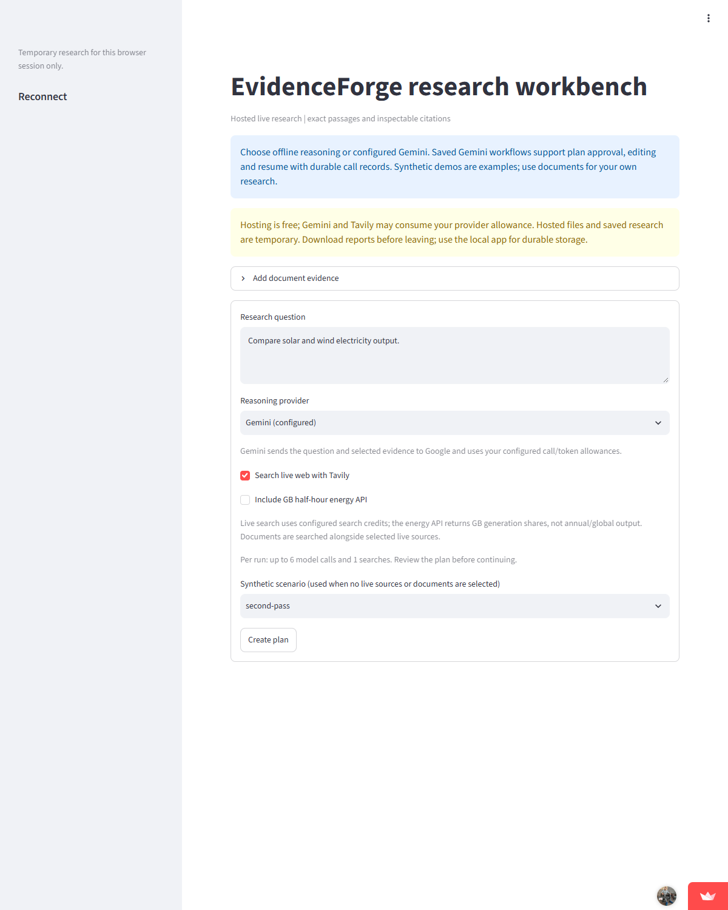

# Hosted live research ready - 14 October 2026

[Open EvidenceForge](https://evidenceforge-ai-akhiltej.streamlit.app/).

After the owner saved both root-level API key entries, an independent fresh
anonymous browser reached the hosted research form. This is a genuine screenshot
of the deployed app, not a locally rendered results page.

## Hosted checks

| Check | Result |
|---|---|
| Password/sign-in form absent | Passed |
| Create plan visible | Passed |
| Gemini configured selected | Passed |
| Tavily live search selected | Passed |
| Caller-selected workspace field absent | Passed |
| Setup error absent | Passed |

The initial check used an exact-text locator for the provider dropdown and did
not read its selected value. Visual inspection already showed Gemini selected.
The corrected check reads the combobox value and all six checks passed. The
initial result and screenshot remain private for traceability.

No research was started and this verification requested zero Gemini/Tavily
calls. It verifies hosted setup and controls, not a fresh paid generation or
broader research accuracy. Independent visitor separation is covered by the
existing offline UI tests; this hosted check verifies the scope input is absent.

Hosting remains free only. Provider usage can consume credits. Hosted files
are temporary; download reports. Hosted defaults remain up to six model calls
and one search per run, followed by plan review before retrieval continues.

[Configuration repair and 527-test CI](HOSTED_CONFIG_FIX_2026-10-14.md) |
[Earlier bounded live provider test](LIVE_PROVIDER_SCREENSHOT_2026-10-13.md)
