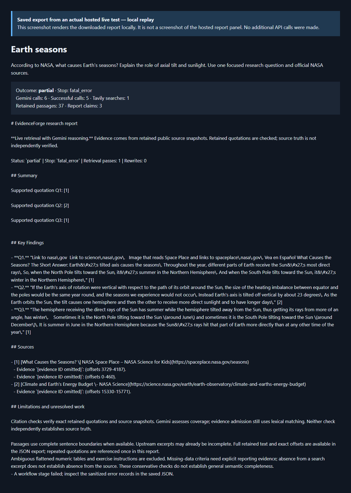
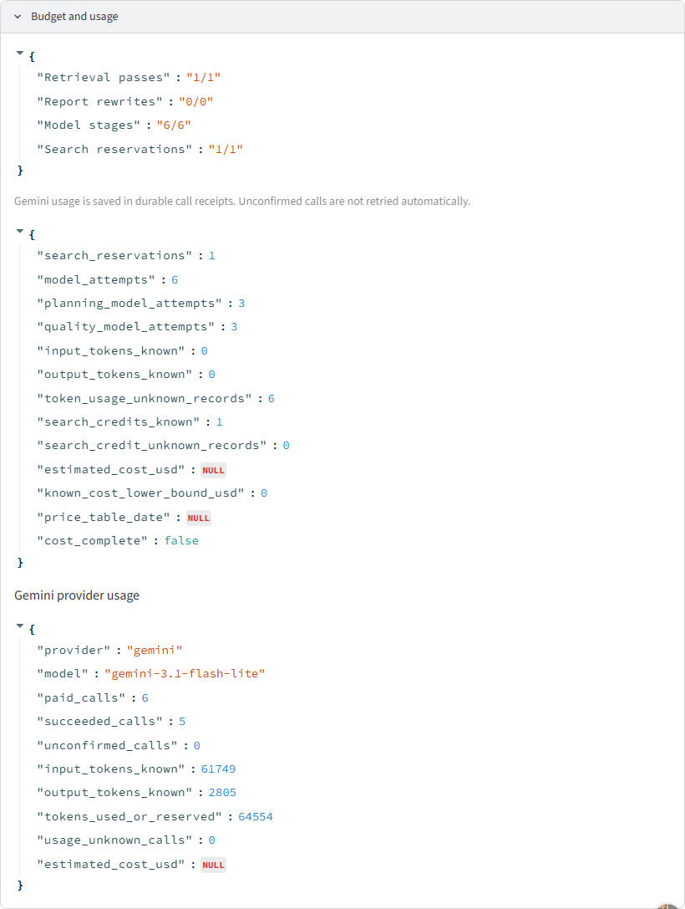
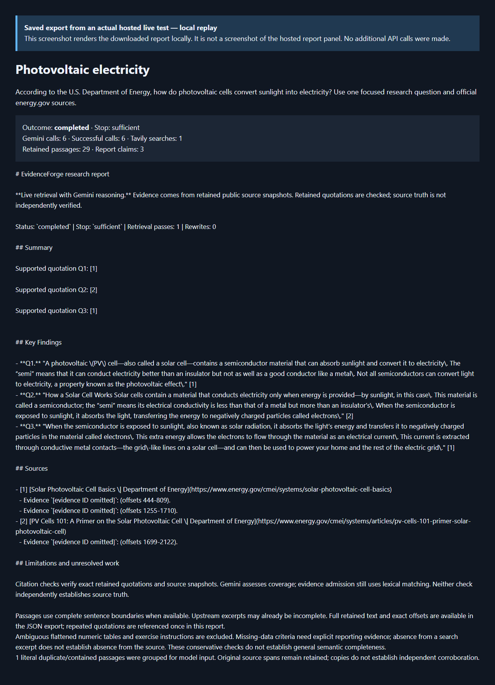
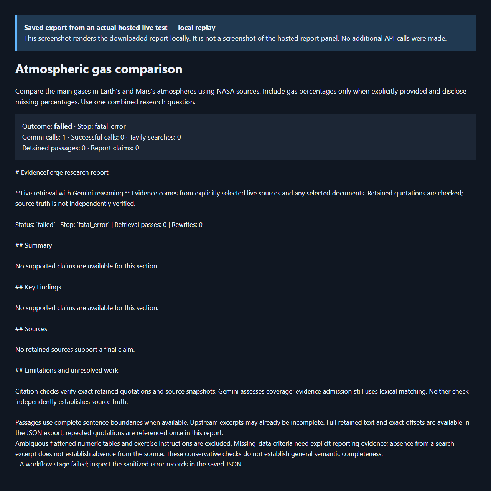
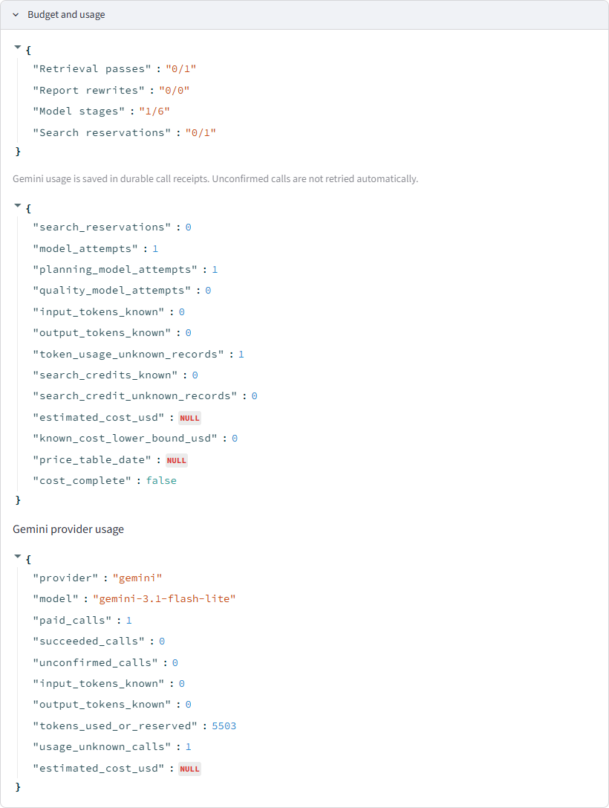

# Three actual hosted Gemini and Tavily tests — 14 October 2026

## Result

Three cases ran through the public [Streamlit app](https://evidenceforge-ai-akhiltej.streamlit.app/), using the configured `gemini-3.1-flash-lite` model and Tavily. **One completed, one ended partial, and one failed before retrieval.** These results verify one successful hosted end-to-end path and expose two model-stage failures; they do not establish general reliability or research accuracy.

The owner approved a separate maximum of **18 Gemini calls and 3 Tavily searches**, plus publishing sanitized screenshots and explanations. Actual usage was **13 Gemini calls and 2 Tavily searches**. The remaining 5 calls and 1 search were not used. Earlier allowances were not reset. Hosting remains free only (INR 0/month); provider calls can consume credits.

| Case | Outcome / stop | Gemini calls (successful) | Tavily searches | Retained passages | Final claims / citation audits |
| --- | --- | ---: | ---: | ---: | ---: |
| Earth seasons, NASA | Partial / `fatal_error` | 6 (5) | 1 | 37 | 3 / 3 |
| Photovoltaic electricity, DOE | Completed / `sufficient` | 6 (6) | 1 | 29 | 3 / 3 |
| Earth/Mars atmosphere comparison, NASA | Failed / `fatal_error` | 1 (0) | 0 | 0 | 0 / 0 |

## Procedure and evidence provenance

1. Opened the real hosted app in a fresh anonymous browser session. No API key was entered in the browser automation.
2. Submitted each question once. Each run was bounded to six Gemini calls, one search, one retrieval pass and zero rewrites, with no automatic provider retries.
3. Reviewed and approved the first two plans after their two planning calls. The third case failed on its first model stage and never reached approval or search.
4. Downloaded the actual Markdown and JSON reports, inspected citations and retained passages, and downloaded JSON again. The repeated downloads were byte-identical and did not rerun research.
5. Saved actual hosted **Budget and usage** screenshots. Report screenshots originally hid too much while masking identifiers; those originals remain private. The report images below are **clearly labeled local renderings of the actual downloaded reports**, not captures of the hosted report panel. They preserve outcomes, quotations, source links and limitations, with internal evidence IDs omitted. Rendering these images made no provider calls.

Private run/session identifiers, credentials and original full exports remain outside Git. The [sanitized result summary](HOSTED_LIVE_TESTS_2026-10-14.json) includes checks, public source URLs, provider counters and SHA-256 hashes of the original Markdown exports. This is AI review, not independent human sign-off.

## 1. Earth seasons — partial

**Question:** According to NASA, what causes Earth's seasons? Explain the role of axial tilt and sunlight. Use one focused research question and official NASA sources.

Tavily retrieved five NASA sources. The report retained three cited quotations describing axial tilt, changing sunlight angle and opposite hemispheric seasons. Citation audits supported all three, and the quotations matched the exported evidence. Two sources were cited in the final report: [NASA Space Place](https://spaceplace.nasa.gov/seasons) and [NASA's energy-budget explanation](https://science.nasa.gov/earth/earth-observatory/climate-and-earths-energy-budget).

The run remained **partial**: one of six Gemini calls failed, and the workflow recorded a fatal error. Supported quotations are useful evidence, but they do not make the overall workflow complete. The first quotation also includes navigation clutter, a report-quality limitation.

**Actual hosted usage panel:** six calls, five successful, one search credit.

## 2. Photovoltaic electricity — completed

**Question:** According to the U.S. Department of Energy, how do photovoltaic cells convert sunlight into electricity? Use one focused research question and official energy.gov sources.

All six Gemini calls and the Tavily search succeeded. Five DOE sources were retained; three final quotations explain semiconductor absorption, the photovoltaic effect, electron movement and current extraction through metal contacts. The final report cites [Solar Photovoltaic Cell Basics](https://www.energy.gov/cmei/systems/solar-photovoltaic-cell-basics) and [PV Cells 101](https://www.energy.gov/cmei/systems/articles/pv-cells-101-primer-solar-photovoltaic-cell).

The workflow completed with `sufficient`, no recorded tool errors, and three supported citation audits. All three quotations exactly matched exported evidence. One duplicate/contained passage was grouped for model input; repeated text does not establish independent corroboration.

**Actual hosted usage panel:** six calls, all successful, one search credit.

## 3. Atmospheric gas comparison — failed before search

**Question:** Compare the main gases in Earth's and Mars's atmospheres using NASA sources. Include gas percentages only when explicitly provided and disclose missing percentages. Use one combined research question.

The first Gemini stage failed before planning completed. Tavily was **not invoked**. No sources, passages, claims or citation audits were produced. The report explicitly states that no supported claims are available. This is a failed research case, not a successful empty answer or a Tavily failure. No retry was submitted.

**Actual hosted usage panel:** one failed call, zero searches, actual token usage unknown for that call.

## Measured usage

| Case | Known input tokens | Known output tokens | Tokens used or reserved | Calls with unknown token usage |
| --- | ---: | ---: | ---: | ---: |
| Seasons | 61,749 | 2,805 | 64,554 | 0 |
| Photovoltaics | 47,364 | 2,608 | 49,972 | 0 |
| Atmospheres | 0 known | 0 known | 5,503 reserved | 1 |
| Total | 109,113 | 5,413 | 120,029 | 1 |

Known actual tokens total **114,526**; **120,029 is a used-or-reserved figure**, not actual consumption. Actual usage for the failed atmosphere call is unknown. There were eleven successful and two failed Gemini calls, with zero unconfirmed receipts. Tavily recorded two known search credits. USD cost was unavailable and must not be interpreted as zero.

The hosted panel shows both a generic workflow summary and **Gemini provider usage**. The generic summary has zero known tokens and unknown-usage records; actual Gemini token figures above come from the separate provider counters. The first private collection script mistakenly picked generic zero fields when parsing duplicated names. Original artifacts were preserved; the published summary parses numeric counters only after the provider-usage heading and was checked against the screenshots.

## Checks and remaining findings

- All three cases stayed within their caps; repeated JSON downloads were stable; exported credential fields were absent.
- Both cases with findings had unique claims, supported server citation audits and exact quotation-to-evidence matches. The empty failed case did not pass nonempty-finding or citation checks.
- Exact quotation checks verify retained text and provenance. They do not independently establish source truth, semantic completeness or broad research accuracy.
- Two model-stage failures remain unresolved. Public exports expose error counts and fatal stop reasons but omit detailed tool-error records, despite the Markdown directing readers to those records. These artifacts cannot establish an exact HTTP status or root cause; none is guessed here.
- No LangSmith call was requested by this campaign. Prior tracing verification remains separate.
- This was a documentation/evidence update. Application source was unchanged; the prior 527-test source CI is historical and does not imply that all three live cases passed.
