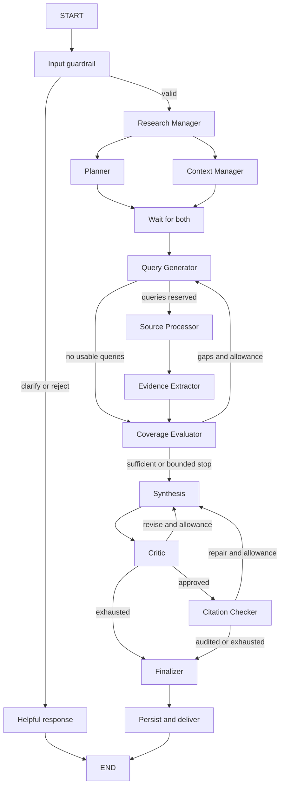

# EvidenceForge AI implementation plan

Prepared: 30 September 2026, Asia/Calcutta. Phase 0: planning.

## 1. Source authority and repository inspection

The user authorized Phase 0 after the plan review. This document specifies proposed implementation; later milestones require an instruction to proceed.

Workspace: C:/Users/AKHILTEJ/Documents/ChatGPT/AI Research agent. Initial inspection found only .git, no commits on master, and no application, tests, manifest, or project instructions. No ancestor AGENTS.md was found. Instructions in unrelated projects do not apply.

Available reference: C:/Users/AKHILTEJ/Downloads/CODEX_HANDOFF.md, specification 1.0, preserved as docs/CODEX_HANDOFF.md. This plan incorporates the review corrections without changing the original reference.

Missing: original AI Research Agent.pdf, companion AGENTS.md/setup instructions, rubric and deadline. Filename searches covered the workspace, Downloads, Documents and Desktop. Likely Downloads archives were inspected by entry name, but no assignment PDF was established. It could exist elsewhere or under another filename.

**All PDF page mappings and the reported 23-page count are handoff-only, unverified against the PDF.** Planning can proceed; assignment sign-off cannot. When the original is supplied, read every page and reconcile this matrix. Offline Phase 1 contracts need not wait for that reconciliation.

User instructions govern scope. Source documents supply reference requirements and proposals rather than independent authorization.

## 2. Scope and delivery gates

The application accepts a question, plans subquestions, gathers evidence, investigates gaps within limits, and produces an inspectable cited report. A graph node is a function; only selected nodes require model calls.

| Gate | Deliverable | Acceptance |
|---|---|---|
| A: Working baseline, Phases 1-4 | CLI, ten roles, planning/context join, fixture and web retrieval, coverage loop, critic/audit, Markdown | Offline second-pass demo and honest insufficient/partial paths; separately reported live smoke result |
| B: Assignment completion, Phase 5 plus reconciliation | Document retrieval, SQLite resume, scoped context, verified baseline | Original PDF mapped; restart/isolation/document citation checks; API/MCP obligation resolved |
| C: Competition additions, Phases 6-9 | Claim inspection, contradictions, ranking, simple demo UI, measurements | Inspectable passages and actual human-reviewed comparison results |

Baseline inferred from the handoff: planning, source-specific queries, evidence processing, shared state, adaptive coverage, bounded critique, citations, persistence, and required report sections. Engineering controls accompany these components: validation, provenance, budgets, typed failures, access boundaries and honest termination.

Proposed enhancements: claim graph visualization, contradiction follow-up, explainable ranking, modes, plan approval, API, exports and benchmark comparisons. Defer vectors, multiple providers, a second frontend, multilingual reports and deployment until justified. An external fixture/interface does not prove a live MCP connection.

## 3. Requirement traceability

Every page reference below is **handoff-only**. Application paths are relative to src/evidenceforge/ unless otherwise stated. Files are proposed and created incrementally.

| ID | Requirement/guidance | Reported pages | Proposed files | Acceptance check |
|---|---|---|---|---|
| B01 | Focused subquestions | 2, 6, 8-9 | nodes/planner.py; schemas.py | Atomic questions, stable IDs and criteria |
| B02 | Web, document, API/MCP paths | 2, 5-6, 10 | retrieval/base.py, fixtures.py, tavily.py, documents.py; later external adapter | Common results/errors; web/docs work; live MCP obligation confirmed |
| B03 | Manager coordinates Planner/Context initialization | 5, 8-9 | nodes/manager.py, context.py; graph/builder.py | Both branches finish; query generation once |
| B04 | Source-specific queries | 9-10 | nodes/queries.py | Question/source links, bounded counts and repeats |
| B05 | Extract relevant passages, deduplicate, provenance | 10-11 | evidence/extraction.py, deduplication.py | Exact spans, retained source/query links and rejection reasons |
| B06 | Shared state and reducers | 7-8 | graph/state.py; schemas.py | Partial updates, replay-safe merges, serialization |
| B07 | Missing coverage triggers follow-up | 11-12, 15 | nodes/coverage.py; graph/routing.py | Targeted second retrieval pass |
| B08 | Iteration stop with incomplete disclosure | 12, 20 | services/budgets.py; graph/routing.py | Bounded stop preserves gaps |
| B09 | Markdown Summary, Key Findings, Sources | 13 | nodes/synthesis.py; report renderer; cli.py | Deterministic citations; every factual sentence audited |
| B10 | Critic requests revision | 13-16 | nodes/critic.py; graph/routing.py | Concrete brief, shared rewrite limit, partial result on exhaustion |
| B11 | Trace factual claims to evidence | 14 | nodes/citations.py; schemas.py | ID validity, support, attribution and complete claim coverage |
| B12 | Register/compile LangGraph | 14-16 | graph/builder.py, state.py, routing.py | Executable graph and routing tests |
| B13 | SQLite checkpoints/thread_id | 16, 23 | storage/checkpoints.py; services/research.py | Process restart/resume, isolation, fresh-run reset |
| P01 | Environment secrets | 3-4 | config.py; .env.example; .gitignore | Missing-key response; no secrets in logs/state/git |
| P02 | Validate research input | 19 | guardrails/inputs.py | Rejection/clarification reason and explicit scope policy |
| P03 | Observe execution/usage | 20 | services/events.py; observability/usage.py, tracing.py | Sanitized call/routing records and actual trace coverage |
| P04 | Tool errors/provider fallback | 21 | model/retrieval adapters; retry policy | Bounded retry; configured permitted fallback |
| P05 | Bounded evidence/prior summaries | 21 | evidence/extraction.py; storage/reports.py | Byte/count caps, citation pinning, summaries as context |
| P06 | Phase-specific tools | 22 | graph dependency construction; adapter contracts | Planning/critique cannot gain tools; retrieval read-only |

Tests will live in tests/unit/, tests/integration/ and curated tests/fixtures/.

## 4. Ten core roles

| Role | Output | Implementation |
|---|---|---|
| Research Manager | Initialized run, intent and immutable limits | Deterministic initially |
| Research Planner | Atomic questions/criteria | Structured model adapter; fixture default |
| Context Manager | Scoped document/prior-summary references | Repository/search code |
| Query Generator | Source-specific questions/gap queries | Structured adapter plus validation |
| Source Processor | One dispatched retrieval batch with errors | Bounded async orchestration |
| Evidence Extractor | Admitted exact passages/rejection records | Rules plus optional structured selection |
| Coverage Evaluator | Per-question status, gaps and verdict | Rules plus structured assessment |
| Synthesis | Structured claims/report | Model adapter and deterministic renderer |
| Critic | Approval/revision brief | Structured adapter |
| Citation Checker | ID/support/attribution/completeness audit | Deterministic checks and fallible semantic evaluator |

Guardrail, finalizer, budget service, call ledger, event publisher, ranking, contradiction service and graph projection support the roles. They do not require separate assistants. Runtime clients/connections are injected outside serializable state. CLI and later UI/API share an application service.

## 5. Graph and routing

The input guardrail currently executes at the application service boundary before graph invocation. It returns a bounded accepted/rejected/needs_clarification decision and blocks clearly vague requests before model/search calls. This is a small explicit topic policy, not a semantic safety or answerability classifier. The diagram shows that boundary conceptually.

The diagram join means an all-predecessor barrier. Implement add_edge(["planner", "context_manager"], "query_generator"), with distinct branch writes. Separate predecessor edges are not the specified barrier. A failed required initialization branch terminates; an unavailable optional context source returns empty context plus disclosed error. Source Processor is the retrieval dispatcher, avoiding duplicate retrieval.

| From | Edge type | Destination/condition |
|---|---|---|
| START | Fixed | Guardrail |
| Guardrail | Conditional | Manager if valid; terminal helpful response otherwise |
| Manager | Fixed fan-out | Planner and Context Manager |
| Both branches | Fixed all-source join | Query Generator, once both finish |
| Query Generator | Conditional | Source Processor for nonempty reserved queries; coverage otherwise |
| Source Processor | Fixed | Evidence Extractor; complete pass counted once |
| Evidence Extractor | Fixed | Coverage; optional enrichment later before coverage |
| Coverage | Conditional | Queries for useful gaps with capacity; synthesis for sufficient/bounded stop |
| Synthesis | Fixed | Critic after a validated draft; typed failure otherwise |
| Critic | Conditional | Synthesis for permitted revision; citations if approved; finalizer if exhausted |
| Citations | Conditional | Synthesis for permitted repair; finalizer on audit/exhaustion |
| Finalizer | Fixed | Idempotent persistence/delivery then END |

A citation repair returns through Critic again. Use fixed edges or conditional routing/Command per node; avoid mixing dynamic routes with fixed outgoing edges. Later approval is a dedicated interrupt node after the join and before retrieval. Contradiction follow-up shares existing budgets.

## 6. State and reducers

TypedDict describes graph state; Pydantic validates external/model records. TypedDict alone is not runtime validation. Use consistent JSON-compatible checkpoint representations. Optional enhancement fields remain absent/empty until needed.

| Fields | Update contract |
|---|---|
| run_id, thread_id, owner_scope, schema_version, original request | Immutable after initialization; service rejects conflicts |
| research_questions, plan_version | Versioned planner overwrite; edited plan invalidates dependent queries/coverage |
| context_refs | Context branch overwrite, independent of planner |
| search_queries, coverage_by_question, coverage_status, gaps | Overwrite current version/batch |
| attempted_query_keys | Union by normalized query/source/scope |
| source_records, raw_result_refs, evidence_store, rejected_evidence | Stable-ID merge; identical replay no-op; immutable conflicts rejected |
| source_quality, contradictions, claim_evidence_map | Later versioned projections; explicit stale-entry replacement |
| draft_report, report_claims, critic_verdict, revision_brief, citation_audit, final_report | Overwrite current draft; rewrite clears stale audit explicitly |
| iteration_count, revision_count, stop_reason, run_status, timestamps | Single-owner overwrite; completed passes/reserved rewrites counted once |
| budget, usage | Budget service owns transactional reservations; merge usage by call ID; totals derived from ledger |
| messages, events, tool_errors | Bounded ID-based merge; add_messages only for real LangChain messages; sanitized events |

Reducers must be deterministic under replay/branch order. Nodes return partial updates rather than mutate shared state. Empty updates do not clear merged fields; define explicit reset/replacement. Initialize a fresh run with fresh identities/counters/draft/approval instead of inheriting stale state.

Required schemas: ResearchRequest, ResearchQuestion, SearchQuery, SourceRecord, EvidenceItem, ResearchGap, Claim, ClaimEvidenceLink, CitationAuditItem, CriticVerdict, ToolError, BudgetLimits, BudgetReservation, UsageRecord, CallRecord, RunEvent and Report. Add contradiction/ranking schemas in Phase 6. Use enums for statuses, source types and support verdicts.

Source identity includes location and content version; separate acquisition records retain time/query provenance. Evidence identity includes snapshot/locator/span and scope. Hash equality does not imply independent corroboration, permission or truth. Keep large content in artifacts and references in checkpoints.

## 7. Evidence and report contracts

Search discovers sources. Set Tavily result count, depth and raw-content policy explicitly. Its generated answer is not evidence. Request cleaned full content for selected sources or perform bounded extraction; save snapshot, URL/document identity, acquisition time, parser version, content hash and acquisition status before admission.

Validate exact spans against the retained snapshot and page/paragraph/offset locator. If only a useful search excerpt exists, label content_scope=search_excerpt; do not claim full-page verification. Record truncation/inaccessibility/extraction failure. Group syndicated copies as source families; pin cited passages until report/audit persistence.

Document ingestion checks type/size, hashes scoped files, preserves locators and begins with lexical retrieval. Detect scanned/textless PDFs and disclose unavailable OCR. Tune chunking/retrieval on development cases only.

Synthesis returns atomic statements, fact/inference/recommendation kind, evidence links and section placement. Render Summary, Key Findings and Sources from the same records audited. Every factual sentence, including Summary and factual limitations, maps to a claim ID. Only predefined nonfactual connective text may be added outside those records.

Audit IDs/access, specific passage support, qualifiers, attribution and completeness of rendered statements. URL reachability is not truth verification. Human labels evaluate semantic judgments. Repair/remove unsupported claims; partial finalization must not introduce new unaudited prose.

## 8. Budgets and every termination path

Proposed configurable development limits: 3 completed retrieval passes, 2 total report rewrites across critic and citation repair. These are initial defaults, not measured requirements. Bound subquestions, queries, results, bytes, attempts, concurrency, output tokens and elapsed time. Reserve final synthesis/audit capacity first. Track call IDs/reservations/errors with the first live model or search call.

| Condition | Action/status |
|---|---|
| Invalid/vague input | Rejected or needs clarification; helpful response without research |
| Sufficient evidence | Skip further searches and synthesize |
| Missing/disputed coverage with useful new queries/capacity | Targeted follow-up linked to gaps |
| Pass/search/time/cost allowance exhausted; final-stage capacity needed; no progress | Stop retrieval; preserve missing coverage; defensible partial report |
| Zero admitted evidence | Deterministic insufficient_evidence response |
| Critic revision or repairable audit defect | Reserve shared rewrite allowance before another synthesis |
| Rewrite exhaustion | Partial result with supported claims and unresolved audit findings |
| User cancellation | Stop new calls/cooperate with in-flight cancellation; cancelled |
| Fatal configuration/model/infrastructure failure | failed; partial only if a defensible report already exists |
| Graph recursion backstop | Boundary catches failure, preserves artifacts and discloses stop |
| Persistence failure | Surface delivery/persistence failure; do not claim saved/resumable result |

Terminal statuses: completed, partial, insufficient_evidence, failed, cancelled. Input results separately represent rejected/needs_clarification. Later approval adds nonterminal paused. completed requires coverage, successful audit and no blocking critic finding. Do not set sufficient merely to terminate.

iteration_count counts completed retrieval batches (including failed/empty batches), incremented once. Graph supersteps are separate. Detect no progress from new admitted independent evidence and unchanged gaps, not source counts. Bound retries/backoff; fail authentication promptly; fallback requires explicit compatible provider/data policy.

Persist stable call identity and reservation before an external operation; record response and usage before use. Reuse completed records on resume. A crash between external completion and local recording leaves an ambiguous call: retry may charge again, so define a deliberate configured recovery policy and disclose uncertainty. Do not promise exactly-once provider billing.

SQLite checkpoints persist workflow position; separate report/artifact/call repositories store outputs/evidence/summaries/operations. Match async execution with async saver lifecycle. thread_id is not authorization. Validate ownership; new runs reset all control state. Prior generated reports provide context, not independent evidence.

Code before an interrupt may rerun; place approval in its own node. Emit sanitized event DTOs rather than raw state streams; private state schemas alone do not redact streams. Retrieved content cannot grant tools or expose secrets. Private-document cloud processing/tracing needs an explicit policy.

## 9. Evaluation introduced during development

Phase 1 defines development-case contracts; fixtures arrive with their components in Phases 2-4: sufficiency, second pass, unanswerable input, unrelated citation, numeric qualifiers, malformed outputs and provider errors. Add scoped document/restart cases in Phase 5 and real/date/unit/unrelated dispute cases in Phase 6.

Phase 9 expands toward 20-30 diverse questions and untouched held-out partitions. Freeze prompts/retrieval/model/budgets before held-out runs. Tune on development cases only; exclude test labels/questions from memory.

Use a common human-labeled reference corpus/aspect set to score answer support across one-shot, one-pass retrieval and full graph. Separately report support by each system's retrieved evidence and citation completeness; mark evidence-specific metrics N/A where appropriate. Lack of retrieval is not proof every statement is false.

Match model/source snapshots and disclose budget differences. Ablations isolate loops, contradictions, ranking and repair. Record versions, annotations, raw outputs, failures/exclusions, latency/usage/cost and uncertainty. Check LLM judge agreement with human labels. Separate snapshot reproducibility from live freshness. No fabricated result values.

## 10. Official API checks and dependency policy

Checked 30 September 2026. Documentation validates design; no installation, resolver, lockfile or import/runtime test was performed in Phase 0. Phase 1 resolves actual compatible versions and smoke-tests relevant contracts.

| Decision | Official reference |
|---|---|
| StateGraph, TypedDict, partial updates, per-field reducers; compile graph | [Graph API](https://docs.langchain.com/oss/python/langgraph/graph-api) |
| List-based add_edge waits for all predecessors; confirm installed version | [add_edge](https://reference.langchain.com/python/langgraph/graph/state/StateGraph/add_edge) |
| Interrupt resumes restart node; dedicated node/idempotent work | [Interrupts](https://docs.langchain.com/oss/python/langgraph/interrupts) |
| Separate SQLite package; async saver for async graph; local scope | [Checkpoints](https://reference.langchain.com/python/langgraph/checkpoints) |
| Structured validation through adapter; verify chosen provider support | [Structured output](https://docs.langchain.com/oss/python/langchain/structured-output) |
| Optional raw content; explicit search options/snapshots | [Tavily Python SDK](https://docs.tavily.com/sdk/python/reference) |

Initial intent: compatible supported Python 3.11+, Pydantic, minimal LangGraph/LangChain core, configuration loader, one provider when chosen. Add Tavily in Phase 3 and pypdf/python-docx/SQLite checkpointer in Phase 5. pytest/Ruff/type checker form dev tools. UI/API/tracing/vector dependencies are later groups.

Resolve the smallest Phase 1 set; record tested versions instead of installing all integrations. Gemini is selected; gemini-3.8-flash remains unavailable with HTTP 503. The authorized gemini-3.5-flash-lite fallback is configured and live structured generation is verified. No free quota is assumed. Fixture interfaces remain available. Private document/context passages are sent to Google only by an explicitly started Gemini research run.

## 11. Milestones and proposed files

| Phase | Additions | Gate |
|---|---|---|
| 0 | Plan, progress, handoff reference | Inspection/provisional mapping/contracts documented; PDF reconciliation open |
| 1 | pyproject.toml/lockfile/.env.example/.gitignore; minimal package/config/schemas/state; contract tests | Installable offline foundation; schemas, config, serialization, reducer/reset checks |
| 2 | Manager/Planner/Context/Queries; builder; fixtures | Join once, atomic questions, bounded queries, malformed/scoped context |
| 3 | Retrieval/extraction/dedup/snapshots; budgets/call ledger as needed | Provenance, bounds, typed failures; separately labeled live smoke |
| 4 | Coverage/Synthesis/Critic/Citations/Finalizer/routing/CLI renderer | Second-pass offline demo; honest empty/repair/exhaustion/rendered-claim tests |
| 5 | Documents/lexical search/checkpoints/report and artifact stores | Located citations, restart/scope isolation, PDF reconciliation |
| 6 | Claim graph/ranking/contradictions | Inspectable links; disagreement/date/unit/noncomparable cases |
| 7 | Consolidated guardrails/cancel/retry/usage/tracing | Adverse cases, budget races, redaction, ambiguous-call recovery |
| 8 | Dedicated approval interrupt; Streamlit; FastAPI if needed; JSON export | Real service-backed UI, resume/cancel and sanitized reconnect |
| 9 | Dataset/partitions/baselines/ablations/runner/results | Frozen settings, human labels, actual comparisons/limitations |
| 10 | Useful external adapter and deployment preparation | Confirmed need, current hosting checks, local smoke; publishing separately authorized |
| 11 | README/demo/checklist/results/setup/limitations | Only implemented features and measured results; verified rubric mapping |

Code under src/evidenceforge/, tests under tests/, requirements/design/progress under docs/. Create files as needed rather than scaffolding empty future modules. Ignore private documents, databases, traces, secrets and generated caches.

## 12. Assumptions, open questions and risk responses

| Issue | Response/timing |
|---|---|
| Missing PDF/AGENTS/setup | Provisional mappings; read/reconcile supplied originals before assignment sign-off |
| Rubric/deadline unknown | Gate A first; verify competition priorities when supplied |
| Live MCP mandatory? | Interface/fixture provisional; move live adapter earlier if required |
| Provider/budget/access unknown | Offline Phase 1; establish before live work |
| Hallucinated citations/support | Stored spans, complete claim registry, human evaluation |
| Runaway spend/rewrites | Reservations and limits with first calls; shared rewrite/no-progress stop |
| Crash repeats charges | Recorded-call reuse; explicit uncertain recovery |
| Private-data policies | Scoped local stores, no secret state, explicit cloud/tracing choice |
| SQLite concurrency | Local demo; async lifecycle/restart tests; reconsider for deployment |
| API changes | Official docs plus installed-version checks/lockfile |
| Evaluation leakage | Development tuning, frozen test partitions, memory isolation |
| Excess scope | Finish baseline before enhancements; measurable acceptance gates |

Default proposals: solo learner, local CLI/demo, one provider, Tavily, SQLite, and no arbitrary application code execution/write tools. Change assumptions when user instructions or verified assignment require it.

## 13. Current progress and next action

Phases 0-7 provide the local/offline research foundation. The current audit and its qualification
are recorded in PHASE0_7_VERIFICATION.md; PROGRESS.md holds the current executed checks.

Phase 8 is the interaction/export layer: a service-backed local UI, plan approval, sanitized
progress, scoped evidence inspection and exports. The user authorized Phase 8 on 2 October 2026.
Phase 8 is now verified for local/offline use: versioned editing/approval, UI, timeline, coverage,
budget/usage, cancellation/reconnect, scoped inspection and exports. Final full regression: 314 passed.
Implementation and verification are recorded in PHASE8.md and PROGRESS.md. Gemini plan approval/edit/resume now uses scoped durable model receipts, restored budgets and completed-response replay. Unconfirmed calls block automatic retry; historical paid runs without receipts cannot migrate. New runs require a fresh model and service.

Live web research, external API/MCP obligation, original assignment PDF reconciliation and
research-quality benchmarks remain separate open gates. Do not infer completion from passing
synthetic workflow tests. Phase 9 requires the user's next instruction after Phase 8 verification.

Phase 9 implementation and initial measured runs are recorded in evaluation/PHASE9_REPORT.md;
independent annotation review and a successful matched Gemini comparison remain open.
The user explicitly authorized Phase 10 on 4 October 2026 while these gates remain open.
Phase 10 adds a verified public energy-source acquisition command and prepares Docker,
private Render storage configuration and CI. Local source/runtime checks passed; Docker
and hosted platform verification remain pending. Read PHASE10.md and PROGRESS.md.
The user authorized Phase 11 on 4 October 2026. Local submission materials and the synthetic demonstration are prepared; read PHASE11.md and submission/DEMO.md. Next actions are reconciliation against the original PDF/rubric and resolution of the existing review, provider, Docker and hosting gates when their inputs or authorizations are available.

## Current delegated execution — 4 October 2026

Private GitHub upload and Docker CI were authorized and passed. The separately
capped Gemini extension and repairs used 28/40 calls; all 20 one-shots are now
usable, and the repaired workflow completed all nine model stages with an honest
partial/pass-limit result. All 20 labels received a documented AI review.
See evaluation/EXTENSION_REPORT.md and PHASE10.md. Persistent hosting, Tavily access,
original PDF/rubric reconciliation and research-quality validation remain open.
