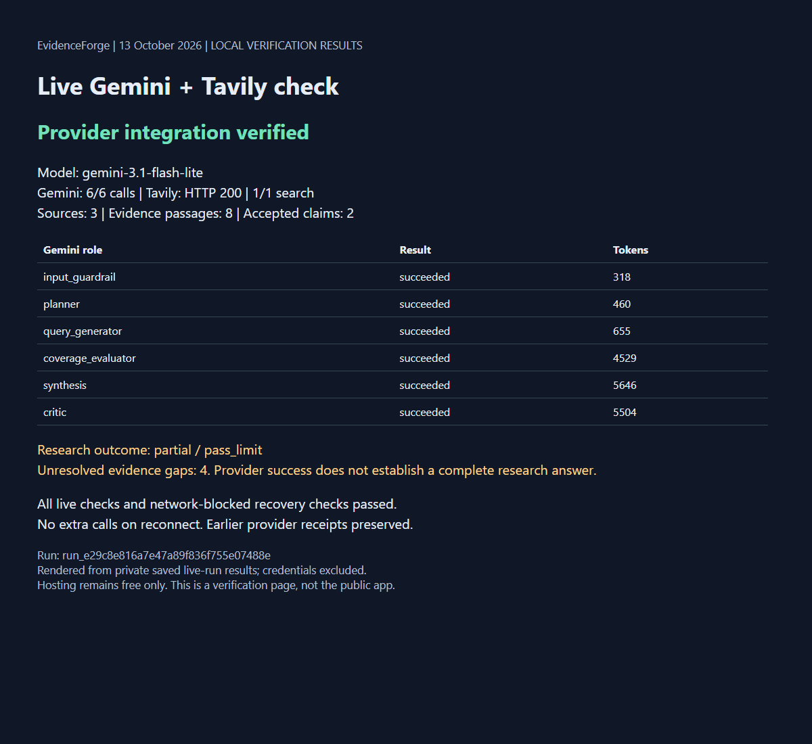

# Fresh live provider test and screenshot - 13 October 2026

## What this screenshot shows

This is a genuine browser capture of a local verification page rendered from
the saved results of a fresh live Gemini/Tavily campaign. It is not a screenshot
of the public Streamlit fixture demo or a provider dashboard. No credentials,
private receipts or full source snapshots are published.

## Measured results

| Item | Result |
|---|---|
| Gemini model | gemini-3.1-flash-lite |
| Gemini calls | 6/6 approved; all six roles succeeded |
| Gemini tokens | 17,112, including reported thinking tokens |
| Tavily | 1/1 approved search; HTTP 200 |
| Search credits | 1 |
| Sources / retained passages / findings | 3 / 8 / 2 |
| Report status | partial / pass_limit |
| Live checks | 8/8 passed |
| Offline checks | 9/9 passed |
| Additional calls on reconnect | 0 |

## Explanation

The question compared Earth's and Mars's atmospheric gases using NASA sources.
All provider roles and the search succeeded. Citation checks confirm exact
retained quotations and offsets; they do not independently establish source truth.
Research sufficiency is reported separately from provider availability.
One quotation includes classroom-material instructions alongside Earth background
text; another concerns isotopic enrichment rather than bulk gas composition.
These exact quotations are not a verified answer to the requested percentage
comparison. All four task criteria remain unresolved in this bounded run.

Unresolved evidence gaps:

- Identifies the main atmospheric gases for Earth.
- Identifies the main atmospheric gases for Mars.
- Provides percentage values for the identified gases where explicitly stated in NASA documentation.
- Explicitly lists any primary atmospheric gases for which NASA-provided percentage values were not found.

The campaign used contract version 6, one retrieval pass, no rewrites and no
automatic paid retries. Its new allowance was explicitly approved separately;
all historical ledgers remained unchanged. Fresh-process recovery was tested
with networking forbidden, restoring identical terminal state without calls.

Run ID: run_e29c8e816a7e47a89f836f755e07488e.

Private artifacts remain in .evidenceforge/verification/gemini-tavily-2026-10-13-02/.
Estimated USD cost is unavailable. Hosting remains free only; no LangSmith
request or hosting change was made. This single test is not broader accuracy
validation; independent human review remains open.

[Previous live check](LIVE_PROVIDER_CHECK_2026-10-13.md) |
[Phase status](FINAL_STATUS_2026-10-13.md)
