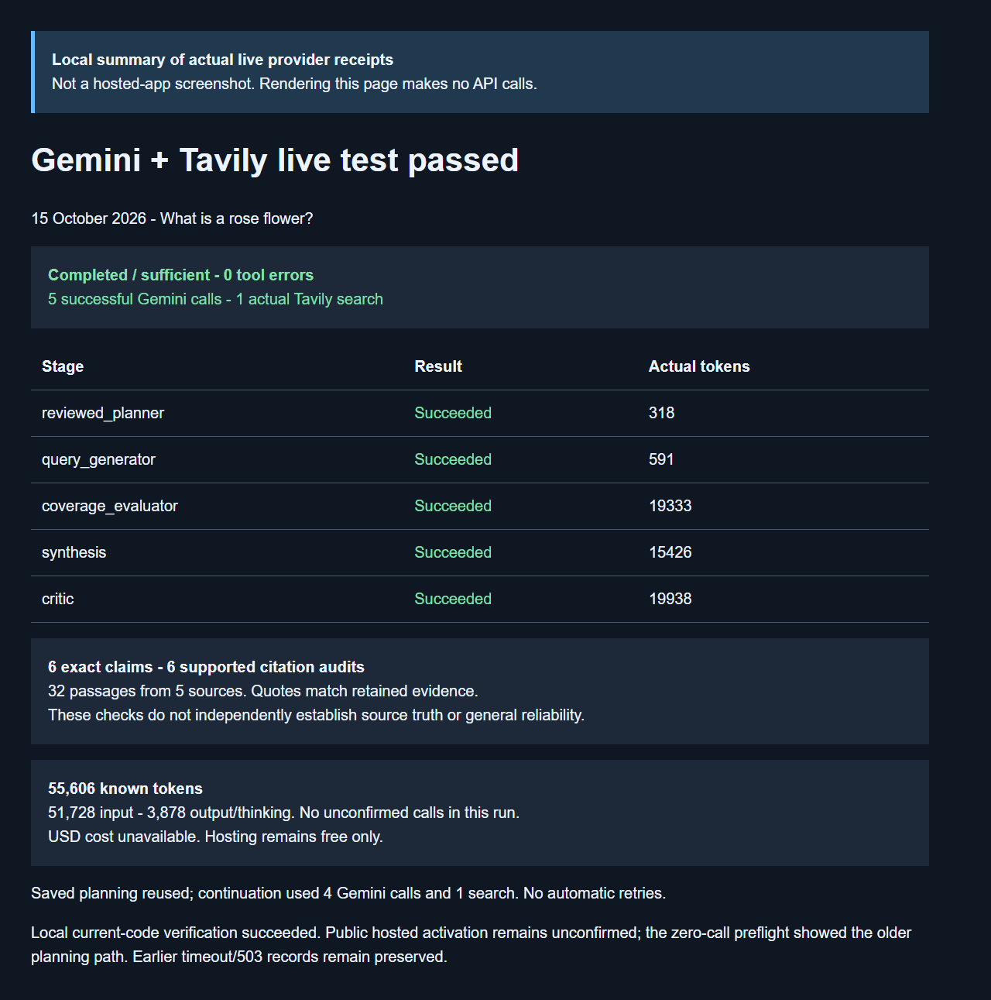

# Live Gemini and Tavily test passed

15 October 2026. Question: **What is a rose flower?**

The **local workbench with real live providers** completed the full current-code workflow: completed / sufficient, five successful Gemini stages, one Tavily search, six report claims and zero tool errors. This was not a hosted UI test.

| Stage | Result | Actual tokens |
| --- | --- | ---: |
| reviewed_planner | Succeeded | 318 |
| query_generator | Succeeded | 591 |
| coverage_evaluator | Succeeded | 19333 |
| synthesis | Succeeded | 15426 |
| critic | Succeeded | 19938 |

## Checks and allowance

- One retrieval pass retained 32 passages from five sources.
- All six claims exactly match their retained evidence; all six structural and quotation citation audits passed. No rewrite was needed.
- Known Gemini usage: 51,728 input and 3,878 output/thinking tokens, totaling **55,606**. This run has no unknown or unconfirmed calls. USD cost is unavailable, not zero.
- Saved planning was reused. The continuation used four Gemini calls and one search with no automatic retries.
- The earlier campaign used three Gemini calls and one search. This run used five calls and one search. Together they exhaust the eight approved calls and two approved searches. Other historical allowances remain separate.
- Exact quotation checks do not independently establish source truth. One successful case does not establish general reliability or semantic completeness.

## Sources retrieved

- [Family: Rosaceae (rose family): Go Botany](https://gobotany.nativeplanttrust.org/family/rosaceae)
- [Rosa - Trees and Shrubs Online](https://www.treesandshrubsonline.org/articles/rosa)
- [Rosaceae - Wikipedia](https://en.wikipedia.org/wiki/Rosaceae)
- [Rosa - an overview | ScienceDirect Topics](https://www.sciencedirect.com/topics/agricultural-and-biological-sciences/rosa)
- [Part 1: The Rose Family: Rosaceae | From the Notebook of a Rosarian…](https://thero2017.wordpress.com/2019/09/11/part-1-the-rose-family-rosaceae)

## Screenshot and records

This screenshot renders actual saved receipts locally, makes no API calls and is explicitly labeled. It is not a screenshot of a successful hosted report. The [sanitized JSON summary](LIVE_ROSE_SUCCESS_2026-10-15.json) excludes credentials, private identifiers and full source passages. The complete report remains in ignored local storage.

## Public deployment

The zero-call public Streamlit preflight still showed the older separate-review path. Hosted activation of the combined-planning repair remains unconfirmed. Hosting remains free only.

This result supersedes the earlier unverified status of the current combined workflow locally. The [earlier timeout and HTTP 503 records](ROSE_RECOVERY_2026-10-14.md) remain preserved. Source commit 86ab08b passed [540 tests and both CI jobs](https://github.com/cakhiltej9001-source/evidenceforge-ai/actions/runs/38606699743). This evidence update changes no product source.
