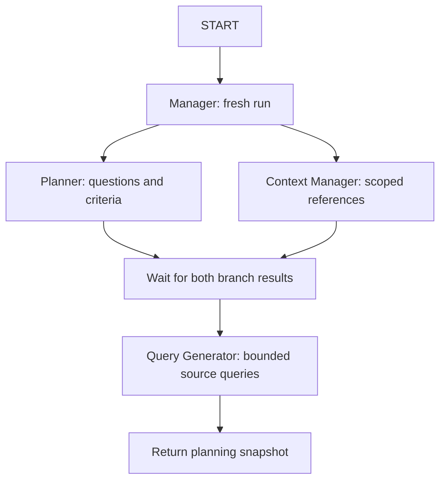

# Phase 2: planning, context and queries

Implemented 30 September 2026. This milestone executes planning with deterministic/scripted
fixtures, without retrieval, evidence extraction, report synthesis or live provider calls.

## Executable graph



graph/builder.py registers four nodes in LangGraph 1.2.12 and uses
add_edge(["planner", "context_manager"], "query_generator") for the all-predecessor barrier.
The integration test makes each initialization branch wait for the other to start, proving
concurrent execution. Query generation asserts both have finished and runs once. Configured
max_concurrency=1 is also supported; in that configuration the branches execute sequentially.

Planner writes research_questions/plan_version; Context Manager writes context_refs.
Both write different stable records to the initialization_results reducer and separate event IDs.
Neither branch writes a competing run-status scalar. Query Generator checks both results before
calling its model interface. Branches return validated partial updates and never mutate input state.

## Interface and record boundaries

| Component | Interface/output |
|---|---|
| PlanningService | async plan(request, budget); creates fresh run/thread and validates result |
| PlanningModel | async plan(request, max_questions); async generate_queries(QueryGenerationRequest) |
| FixturePlanningModel | Default definitions/evidence/limitations templates; optional scripted responses |
| ContextRepository | async select(owner_scope, document_ids, include_prior_reports, limit) |
| InMemoryContextRepository | Filters supplied metadata by owner/requested IDs, sorts and caps results |
| PlanDraft / QuestionDraft | Nonempty question records, nonempty criteria, positive importance |
| QueryBatchDraft / QueryDraft | Linked question IDs, source type, text and permitted purpose |
| ContextBatch | Bounded document/prior-report references |
| InitializationResult | One planner/context_manager result: ready, unavailable or failed |

Runtime clients/repositories stay outside checkpoint state. Raw responses are parsed as JSON, checked
against a UTF-8 byte cap and validated with Pydantic. Extra fields, invalid types/IDs, duplicate plans,
missing criteria and out-of-budget counts are rejected. Model-generated question/query IDs are not
accepted; nodes assign them.

Question text is capped at 1,000 characters and must be a single line with at most one question mark.
These structural checks and fixture examples encourage one focus per record. They do not prove
semantic atomicity, relevance or research quality; those require a live adapter and evaluation.

## IDs, query limits and accounting

Question IDs hash owner, normalized original question and normalized subquestion, so question
ordering does not change IDs. New service invocations still have distinct run/thread IDs.

Query attempt keys include owner, source type and normalized text (case/whitespace ignored).
Repeated candidate queries merge question associations. Conflicting purposes are rejected.
Previously attempted keys are filtered out, while pending queries are not marked attempted.
Query IDs also include pass, sorted question IDs and purpose.

A query pass is iteration_count+1; planning does not increment completed retrieval passes.
Candidate count is bounded by max_queries_per_pass and the remaining max_searches allowance.
Existing reserved/settled searches count against the allowance; released reservations do not.
Drafting a query creates no reservation, usage record or search call. Transactional reservations,
provider usage and paid-call enforcement belong to the retrieval/live-call milestone.

QueryGenerationRequest carries the plan, selected context, gaps and attempted keys for later
follow-up adapters. Default templates are generic offline examples and do not perform intelligent
gap investigation.

## Context isolation

Both the repository and Context Manager check scope. Documents must be explicitly requested;
prior reports must be enabled. Unexpected owners, unrequested documents, duplicate reference IDs,
duplicate targets, disabled prior reports and excessive references produce a typed failure.
The untrusted reference payload is discarded before it reaches graph state.

A requested but missing document is disclosed by count. Optional repository unavailability/timeout
returns an empty context and a sanitized error; web planning can proceed. Document source queries
are enabled only when at least one authorized document reference was selected. Prior reports are
context only and never become sources/evidence. A document-only configuration with no available
document fails explicitly.

The repository holds metadata, not document content. There is no filesystem ingestion or prior-report
database yet. owner_scope is a trusted local caller input; matching an identifier is not authentication.
A later service/API must derive scope from authenticated identity.

## Statuses and failures

| Outcome | Returned state |
|---|---|
| Valid plan/context/queries | planning_status=ready, run_status=running, no finished_at |
| All candidates already attempted | ready with empty pending batch; later graph will evaluate coverage |
| Missing optional context | context_manager=unavailable; usable source queries may proceed |
| Malformed required output or cross-scope context | planning_status=failed, run_status=failed, finished_at/stop_reason recorded |
| Expected adapter failure/timeout | Fixed schema/provider/timeout error; raw exception/output not logged |

Node timeout defaults to 30 seconds and is configurable up to 60 seconds. There are no hidden
retries or provider fallbacks. Unexpected programming errors propagate instead of being reported
as a successful/partial plan.

This graph ends after query generation. Its successful run remains running because research is
unfinished; END here means the planning subgraph ended, not that a report is complete.
No checkpointer, approval interrupt, retrieval dispatcher or report node is included.

## Run and inspect

```powershell
uv run --locked evidenceforge-plan "Compare solar and wind electricity generation."
```

The CLI explicitly labels offline_fixture and orders diagnostic events by timestamp.
The demo's context repository is empty. Programmatic code can inject supplied ContextReference
records through InMemoryContextRepository or implement the repository protocol.

A configured live provider is rejected by the demo without a silent fixture fallback.
build_planning_graph also rejects a model adapter whose is_fixture flag is false.
The planning model/provider has not been selected or integrated.

Tests: test_planning.py, test_planning_context.py and test_planning_queries.py.
See PROGRESS.md for actual check results and DEPENDENCIES.md for the locked environment.
