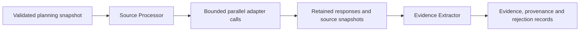

# Phase 3: retrieval and admitted evidence

Implemented 1 October 2026. Planning remains an offline fixture. A compiled retrieval graph
dispatches one search batch, retains source text, and extracts exact, inspectable passages.
Reports and adaptive coverage loops are Phase 4.

## Flow



RetrievalService first runs the existing planning graph and then the registered
source_processor -> evidence_extractor subgraph. Both nodes return validated partial updates.
Successful output remains run_status=running, coverage_status=missing, without a report.
iteration_count increments once per dispatched batch, including empty or failed responses.
A planning failure or absent query batch makes no retrieval calls.

## Adapters

RetrievalAdapter exposes name, is_live and async search(query, options).
RetrievalBatch carries public web sources, content scope, acquisition time and optional reported credits.
Injected adapters and credentials are never included in graph state.

FixtureRetrievalAdapter supplies synthetic energy text at example.org and scripted responses.
It does not perform actual research. Other topics can yield no relevant fixture evidence.

TavilyAdapter uses one fixed HTTPS search endpoint through HTTPX 0.28.1:
basic depth, general topic, automatic parameters disabled, configured result count,
cleaned text requested, generated answer/images disabled and usage requested.
Response bytes are capped while streaming, then normalized and validated.
No returned website URL is fetched directly; redirects and automatic retries are disabled.
Authentication, rate limits, timeout, malformed response and provider errors are typed and sanitized.

Cleaned raw_content is retained as full_text. If absent/blank, the result's content is retained
as search_excerpt, with source access_status=excerpt_only. The generated answer is excluded.
Full text means the provider's cleaned text, not an independently verified original HTML page.
Source ownership/URL credentials/private document types are rejected at the Phase 3 web boundary.
Document/API/MCP dispatch is not implemented; unsupported channels are disclosed.

Official API checks on 1 October 2026:
[Tavily search endpoint](https://docs.tavily.com/documentation/api-reference/endpoint/search),
[Tavily options and result fields](https://docs.tavily.com/sdk/python/reference),
[HTTPX async streaming](https://www.python-httpx.org/async/).
The adapter uses REST directly; no Tavily SDK or additional search provider was installed.

## Retained artifacts and provenance

ArtifactStore stores exact UTF-8 text under a per-owner/run namespace.
References carry full IDs, SHA-256 hashes, byte counts and parser versions.
Physical path components use 128-bit hash fragments to avoid Windows path-length failures;
full content hashes validate reads, and conflicting content cannot overwrite an existing file.
Writes use a flushed temporary file and atomic replacement. Scope/path, size and hash checks
reject missing, corrupted or foreign artifacts. Artifact bytes are capped per run.

The retained normalized response is separate from each source-text snapshot.
Source identity includes owner, URL, content version and full-text/excerpt scope.
Acquisitions link query, source, snapshot and retrieval time. Repeated acquisition of the same
source preserves all query links. Changed source content creates a distinct source version.

Evidence is identified by owner, source, snapshot and character offsets.
The extractor splits retained text into bounded paragraph/windows and verifies stored integrity.
Every admitted passage equals the exact character slice of that snapshot. UTF-8 byte accounting
is separate from character offsets.

Duplicates from the same source/version/span merge acquisition/question associations.
Identical text from different URLs stays separate; this does not prove independent corroboration.
Domain-based source_family is a grouping hint, not a credibility assessment.

## Admission and rejection

Relevance uses lexical overlap with linked research questions and configurable stop words/thresholds.
This is a deterministic admission heuristic, not semantic support, truth verification or source ranking.
Only matching question associations are admitted.

Count, UTF-8 byte and per-source passage caps are enforced. Existing duplicate passages can gain
provenance without consuming another evidence slot. Exact passage payload and original assessment
remain immutable.

Inspect rejected_evidence for irrelevant, duplicate, unavailable_content, content_limit,
snapshot_limit, evidence_limit or parse_failed records.
A duplicate rejection means its redundant candidate was merged into one admitted passage.
Empty content, oversized source text and unretainable snapshots are not silently admitted.
No extracted text can grant tools or execute application code.

## Reservations and durable receipts

CallLedger uses standard-library SQLite for search-operation receipts, separate from workflow
checkpoints. A transaction reserves search capacity and saves stable call/request identity before
the external operation. The request hash covers provider, query and retrieval settings.
Concurrent dispatch shares max_concurrency; reservation transactions prevent search-budget races.

On completion, a retained response, finished call, settled reservation and usage record are saved.
Measured search credits are retained when supplied. Tokens, price and dollar cost remain unknown
unless measured/configured; they are never invented as zero.

The service can reuse completed receipts when supplied the same planning snapshot/run and store.
Completed responses can be reused after the dispatch deadline because they make no new search.
Failed receipts are not automatically retried. Cancellation/programming failure leaves a pending
receipt; a later invocation marks it ambiguous and does not repeat a possibly charged call.
Missing/corrupted completed response artifacts also produce an explicit error without another search.
Do not run two retrieval invocations concurrently for the same run; concurrency within one batch
is supported. Cross-process workflow resume/checkpoint orchestration is still Phase 5.

The receipt ledger does not guarantee exactly-once billing. A provider can complete before local
recording succeeds. Such uncertainty is preserved rather than hidden.

Search count, pass, timeout, evidence and retained-byte limits are enforced.
Elapsed-run allowance is checked before dispatch and bounds the search timeout.
A finite dollar ceiling for live searches is refused because no verified price policy is configured.
This phase makes no live model calls and does not implement a full model/token/cost accounting service.

## Commands

Offline default, no key required:

```powershell
uv run --locked evidenceforge-retrieve "Compare solar and wind electricity output."
```

Data defaults to ignored .evidenceforge; --data-dir can choose another local directory.
Output explicitly says offline_fixture and report_generated=false.

Opt-in live smoke, limited to one potentially billable Tavily search:

```powershell
# Configure EVIDENCEFORGE_TAVILY_API_KEY privately in .env or the environment.
uv run --locked evidenceforge-retrieve "solar electricity output" --live
```

The command refuses a missing key and requires fixture planning mode.
No live search was run during Phase 3 implementation. MockTransport verifies requests and responses
without network connections. Provider quality, live availability and actual billing remain untested.

See PROGRESS.md for actual gate results. Full research reports, coverage loops, semantic auditing,
private-document ingestion and workflow checkpoint recovery remain later milestones.
