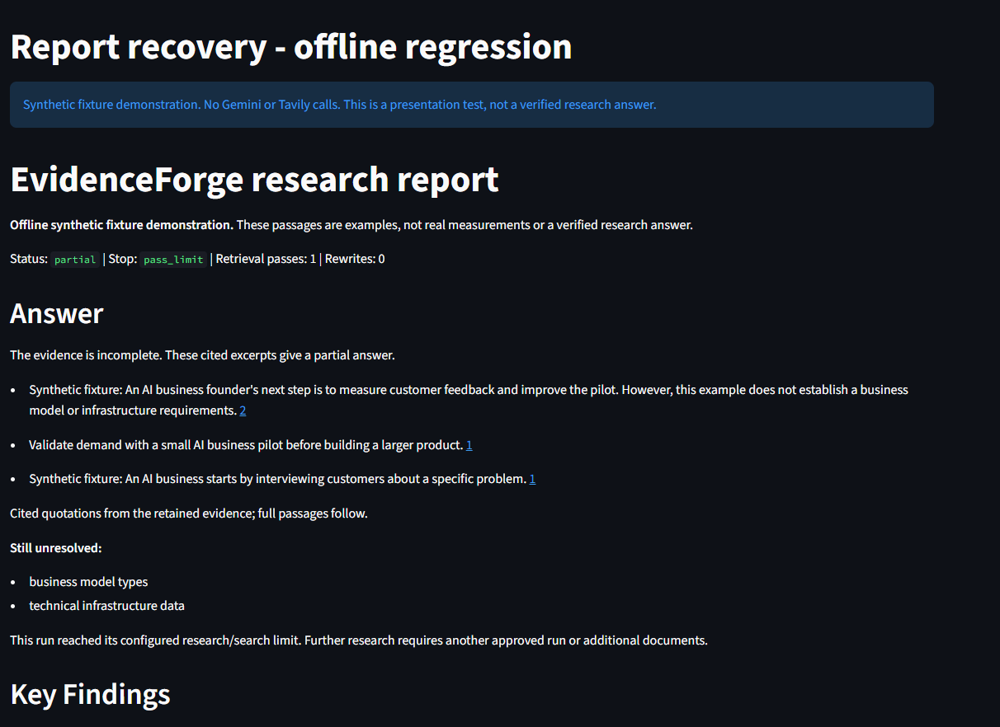

# Research report recovery - 17 October 2026

## Problem addressed

The reported live how-to run reached its one-pass/one-search limit and produced
audited quotations but no short Answer. Only one of three plan requirements was
supported. Gemini's durable receipt panel had known token totals while the general
usage panel reported them as unknown. This repair addresses presentation, accounting
and new-run guidance; missing evidence still produces an honest partial result.

## Changes

- Practical how-to answers use the approved plan's vocabulary and existing
  question-linked coverage assessments as well as the original question.
- Whole cited context can be retained when shortening would remove qualifications.
  Strict factual-question rules and disagreement abstention remain in place.
  Uncited or unaudited passages cannot fill the Answer. Promotional material is
  excluded from answer selection.
- Answer comes before Key Findings. Remaining requirements and the configured
  research/search stop are explained directly beneath it.
- HTML character entities are decoded for reading and escaped again as markup.
  Original claims, saved source passages, offsets and JSON evidence stay unchanged.
- The UI, report JSON export and saved usage JSON reconcile model totals against
  the same scoped durable Gemini receipts. Pending or missing usage stays unknown.
  Dollar estimates remain unavailable without explicit dated prices; partial
  known costs stay a lower bound.
- New local/hosted runs use production policy 3. Its planning, search, selection
  and critic guidance favors the user's practical goal, covering major criteria
  in the limited search, useful source passages and avoiding tangential role
  advice or promotion. Existing saved-run policies keep their original prompts,
  request hashes and replay behavior.
- A ready plan has a visible approval message. A partial run has a clear research
  limit warning rather than relying solely on raw status fields.

Call/search/token limits are unchanged. No automatic paid retry or allowance
reset was added. The answer remains grounded in retained quotations; this change
does not independently establish source truth or guarantee complete coverage.

## Measured checks

- Initial targeted suite: **38 passed in 349.28 seconds**.
- Final recovery suite: **14 passed in 131.33 seconds**. These overlap 12 cases
  with the initial run, covering **40 unique focused tests** altogether.
- Strict typing passed for nine directly affected source files.
- The mock transport checks both legacy policy 2 and new policy 3 use five model
  stages, pause for approval, export known receipt totals and replay without
  extra requests.
- Recovery cases cover changed wording, long qualified context, promotional and
  tangential passages, factual-question guards, disagreements, safe entity
  display, receipt reconciliation, pending/missing usage and dated cost bounds.
- The follow-up punctuation correction passed **21 affected report tests in 95.93 seconds**.
- [Full source CI](https://github.com/cakhiltej9001-source/evidenceforge-ai/actions/runs/39014261618) passed **569 tests in 51.26 seconds** on c06de3c.
- **Zero live Gemini calls and zero Tavily searches** were used for this repair.
  Synthetic transport responses and counters are test fixtures.

## Demonstration and deployment

The demonstration uses synthetic business-guide passages and is explicitly
labeled as an offline regression. It verifies a cited partial Answer and visible
unresolved requirements; it is not evidence of a fresh live provider workflow.

The browser-rendered screenshot also checks decoded apostrophes and safe markup.

[Sanitized synthetic rendering checks](REPORT_RECOVERY_2026-10-17.json).
These counters and passages are fixtures; no provider request was made.

The hosted marker is **App version: 2026-10-17.4**. Both final CI jobs passed, including typing, lint, formatting, build,
checkpoint smoke and container checks. A read-only public check did not observe
this footer yet; hosted activation remains unverified. The owner management
connection timed out, so a reboot was not performed by the agent. A fresh paid end-to-end check requires a new separate
allowance; historical allowances have not been reused. Hosting remains free only.
