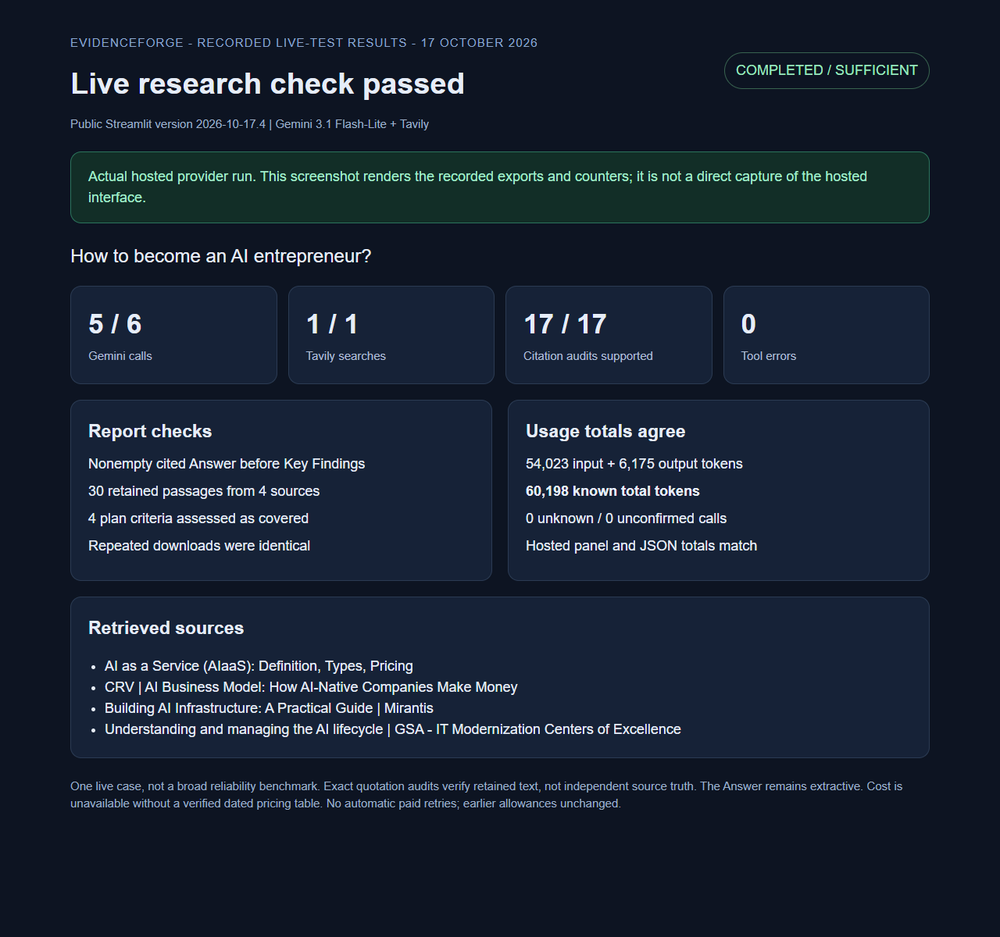

# Hosted live report recovery check - 17 October 2026

## Actual execution

The public Streamlit app was observed at **version 2026-10-17.4** after the owner rebooted it.
One fresh browser session asked: **How to become an AI entrepreneur?**
Gemini created a plan, the agent reviewed it, and the same workflow continued after approval.
The selected provider was Gemini and live Tavily search was enabled.

The user approved a new separate cap of **6 Gemini calls and 1 Tavily search**.
The run used **5 Gemini calls and 1 Tavily search**. All five model calls succeeded;
no calls were unconfirmed and no automatic paid retry ran.
Earlier allowances were unchanged. The sixth Gemini call was unused.

| Measurement | Recorded result |
| --- | --- |
| Model | gemini-3.1-flash-lite |
| Outcome / stop | completed / sufficient |
| Retrieval passes / rewrites | 1 / 0 |
| Retained passages / cited sources | 30 / 4 |
| Citation audits | 17, all structurally valid and supported |
| Tool errors / unresolved gaps | 0 / 0 |
| Known input / output tokens | 54,023 / 6,175 |
| Total known tokens | 60,198 |
| Unknown token records / unconfirmed calls | 0 / 0 |

## What the check establishes

The downloaded Markdown has a nonempty, cited **Answer before Key Findings**.
The 17 final claims exactly match retained evidence, with no duplicated claims.
The workflow assessed all four approved plan criteria as covered: startup stages,
business models, early resources and monetization challenges.

The hosted usage panel and downloaded JSON agree with the provider counters.
Repeated JSON downloads were identical and did not start additional research.
The saved result passed **19 checks**, including allowance limits, known receipt
totals, exact quotations and absent credential fields.

Sources were Domo's AIaaS overview, CRV's AI business model article,
Mirantis's AI infrastructure guide and GSA's AI lifecycle guide.
Raw exports, source excerpts, receipts and session identifiers remain private.

## Recorded-results screenshot

This image renders the saved live-test counters and checks. It is **not a direct
screenshot of the hosted interface** and is not a synthetic provider demonstration.
Creating the image made no additional provider requests.

[Sanitized results and checks](REPORT_RECOVERY_LIVE_2026-10-17.json) |
[Repair and actual component rendering](REPORT_RECOVERY_2026-10-17.md) |
[Final source CI: 569 tests](https://github.com/cakhiltej9001-source/evidenceforge-ai/actions/runs/39014261618)

## Limits

This is one successful case, not a broad reliability benchmark. Coverage is the
workflow's assessment. Exact quotation audits establish correspondence with saved
text, not independent source truth or complete startup advice.
The Answer is extractive: source quotations can retain awkward wording.
No verified dated pricing table is configured, so null cost means unavailable,
not free API usage. Hosting remains free only, with temporary hosted storage.

The hosted activation and fresh Gemini/Tavily checks for this repair are complete.
