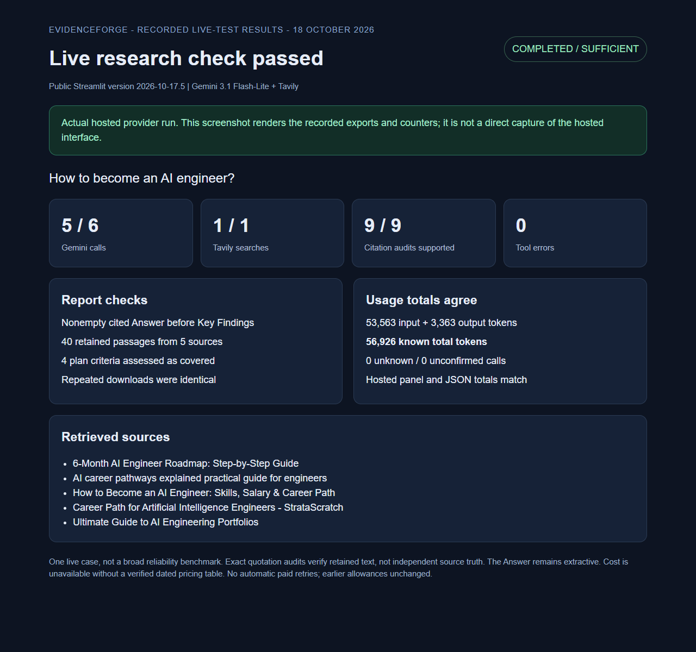

# Fresh hosted Gemini and Tavily check - 18 October 2026

## Actual live execution

The owner requested a fresh live run. One new browser session used Gemini with
Tavily on **App version: 2026-10-17.5** and asked:
**how to become AI engineer ?**

The agent reviewed and approved the generated plan. Its four criteria covered
education, programming tools, mathematics and portfolio projects.
The entire workflow, including report review, completed successfully.

| Measurement | Recorded result |
| --- | --- |
| Model | gemini-3.1-flash-lite |
| Status / stop | completed / sufficient |
| Gemini calls | 5 successful, within the fresh limit of 6 |
| Tavily searches / credits | 1 / 1 |
| Retrieval passes / rewrites | 1 / 0 |
| Retained passages / cited sources | 40 / 5 |
| Claims / supported exact citation audits | 9 / 9 |
| Tool errors / locally blocked requests | 0 / 0 |
| Unknown usage records / unconfirmed calls | 0 / 0 |
| Known input / output tokens | 53,563 / 3,363 |
| Total known tokens | 56,926 |

The Answer was nonempty and appeared before Key Findings in both the hosted
report and Markdown export. The UI and downloaded JSON agreed on token totals.
Repeated JSON downloads were identical. All **20 live-result checks passed**.

The test stopped after one workflow. The sixth Gemini call was unused.
No automatic paid retry ran and earlier allowances were unchanged.

## Recorded-results screenshot

This screenshot renders the saved live counters and checks. It is explicitly
labeled as recorded results, **not a direct capture of the hosted interface**.
Rendering it made no additional provider requests.

[Sanitized counters and checks](REVIEW_BUDGET_LIVE_2026-10-18.json) |
[Repair and offline reconstruction](REVIEW_BUDGET_FIX_2026-10-17.md) |
[Source CI: 583 tests](https://github.com/cakhiltej9001-source/evidenceforge-ai/actions/runs/39036637322)

Raw exports, source quotations, receipts, session IDs and direct UI captures remain
private. Sources included OpenCV, Zen van Riel, Concordia St. Paul, StrataScratch
and DataExpert.

## Limits

This verifies one successful live case. The new plan had four criteria and used
different retrieved material from the earlier failed run; the offline reconstruction
and historical report remain separate records.
Coverage is the workflow assessment. Exact citation audits check retained text,
not independent source truth or complete career advice.
The Answer remains extractive and can retain source wording/formatting limits.
No dated pricing table is configured, so null cost is unavailable rather than
free API usage. Hosting remains free only, with temporary hosted storage.

The fresh live verification item for the review-budget repair is closed.
