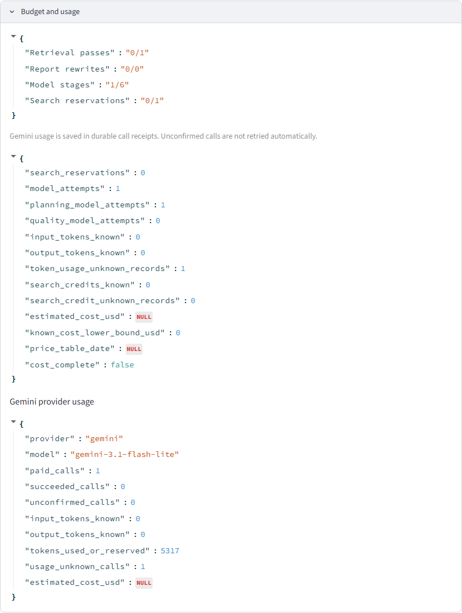
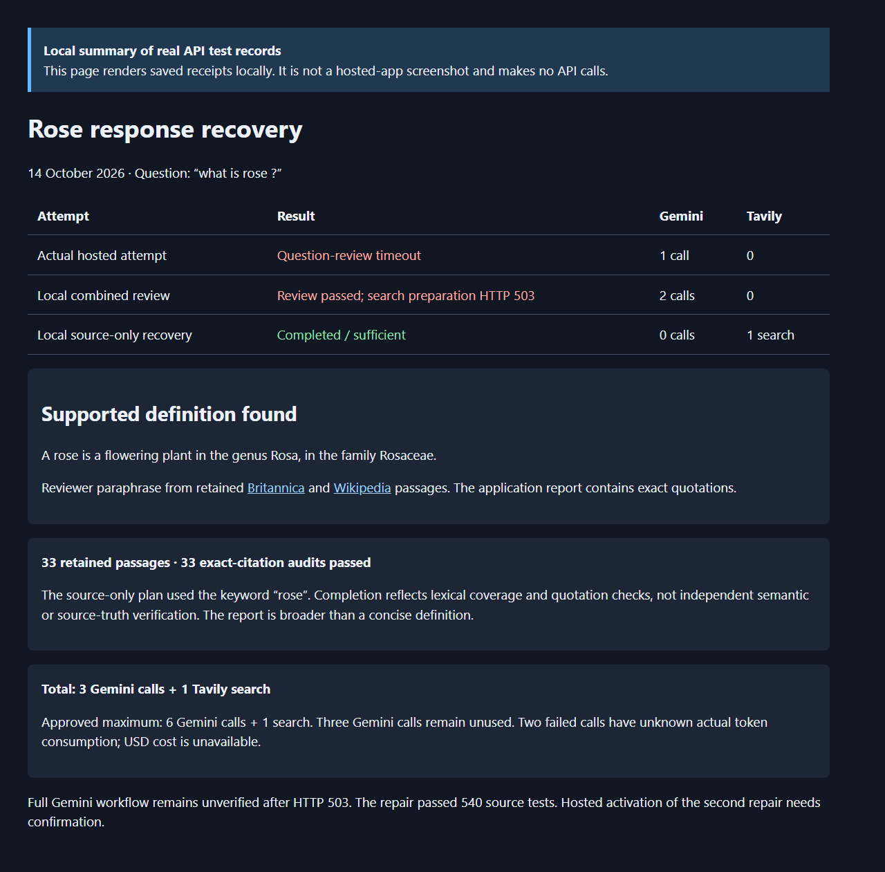

# Rose response recovery — live results

Tests: 14 October 2026. Evidence publication: 15 October 2026.

**The live Tavily source-only recovery completed and returned cited rose passages.**
Gemini completed the new combined question review and plan, then returned HTTP
503 during search preparation. A full Gemini workflow did not complete.

| Attempt | Where | Outcome | Gemini calls | Tavily searches |
| --- | --- | --- | ---: | ---: |
| Original reproduction | Actual public Streamlit app | Question review timed out; no evidence | 1 | 0 |
| Combined review/planning repair | Local workbench, live Gemini | Review and plan passed; query generation returned HTTP 503 | 2 | 0 |
| Source-only recovery | Local workbench, live Tavily | Completed / `sufficient`; 33 retained passages and 33 supported exact-quotation audits | 0 | 1 |

The second hosted attempt stopped at deployment preflight because it did not
observe the combined-planning build. It submitted **zero provider requests**.
The local checks used the same workbench implementation as the public app, but
are not evidence that the repaired Gemini workflow succeeded on Streamlit.

## The response available

The retained sources support this concise definition: **a rose is a flowering
plant in the genus Rosa, in the family Rosaceae**. This is a reviewer paraphrase
of retained [Britannica](https://www.britannica.com/plant/rose-plant) and
[Wikipedia](https://en.wikipedia.org/wiki/Rose) passages. The application report
contains exact source quotations.

One real Tavily search retained five sources, including the
[American Rose Society](https://rose.org/a-little-botany). The source-only plan
made the botanical interpretation explicit and used the keyword `rose` for
lexical coverage. All 33 quotation audits passed, and every claim matched its
retained evidence passage. These checks do not establish that all 33 passages
are equally relevant, independently true, or a concise answer. The report is
broader than the short definition above and has no Gemini semantic assessment.

## What changed

- New workbench runs combine semantic review and planning into one structured
  response. Rejected requests cannot carry a plan; accepted plans still pass
  cardinality, distinctness and scope validation and require approval.
- New Gemini workbench requests use a 45-second transport timeout inside
  60-second node limits. Flash-Lite's combined review uses its supported
  `minimal` thinking setting. The normal one-pass workflow uses five model calls.
- Explicit fresh retries and source-only recovery preserve earlier failed runs
  and usage records. No automatic paid retry or increase in per-run caps was added.
- The UI and JSON downloads expose fixed safe errors and available HTTP status
  codes. Provider error bodies, credentials and private identifiers remain private.

See [implementation and recovery steps](HOSTED_RECOVERY_2026-10-14.md).
Source commit `86ab08b` passed
[540 tests in 31.11 seconds and both CI jobs](https://github.com/cakhiltej9001-source/evidenceforge-ai/actions/runs/38606699743).
Lint, formatting and strict checking of 88 source files passed. The 43 targeted
offline regressions covered the new five-call path, rejection, approval, restart,
legacy six-call behavior and both UI recovery controls.

## Screenshots and provenance

**Actual hosted usage panel** from the first live attempt: one Gemini call, zero
searches, unknown actual token consumption. No API key is displayed.

**Local summary rendered from actual saved test records.** This is a labeled
receipt summary, not a screenshot of a successful hosted report. Rendering it
made no API calls.

The [sanitized machine-readable summary](ROSE_RECOVERY_2026-10-14.json) records
the outcomes and public source URLs. Original exports and failed receipts remain
in ignored local verification storage. Full source passages, internal IDs and
credentials are not published with these screenshots.

## Allowance used

The owner approved a separate maximum of **6 Gemini calls and 1 Tavily search**.
Actual use was **3 Gemini calls and 1 search**. Three Gemini calls remain unused;
no search allowance remains. Earlier campaigns were not reset.

Known Gemini input/output tokens total **318** (201 input, 117 output).
The used-or-reserved total is **12,220**, including reservations for two failed
calls whose actual token usage is unknown. There are no pending ledger entries.
USD cost is unavailable, not zero. Hosting remains free only.

## Getting a response while Gemini is unavailable

On a failed Gemini run, choose **Get source quotations without Gemini**, review
the new plan and approve it. Alternatively, start a new question with **Offline**
reasoning and **Search live web with Tavily** checked, then create and approve
the plan. This searches real sources and uses search credits, with no Gemini
generation. It is distinct from the synthetic fixture demo.

Gemini availability remains an external dependency. The HTTP 503 is preserved as
a failed result; the successful source-only run is not presented as Gemini success.
