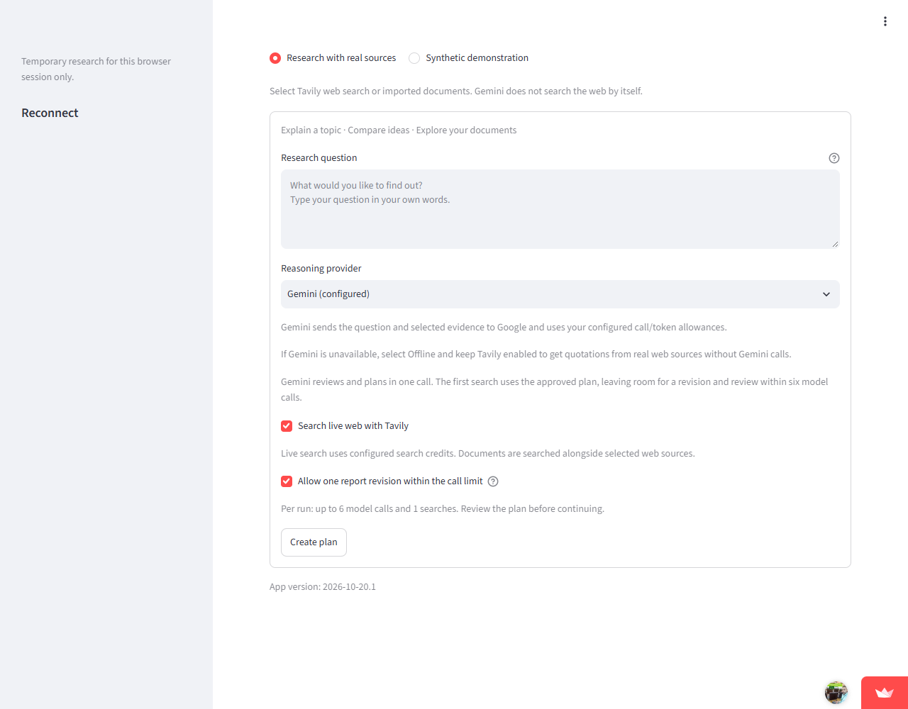

# Report and bounded revision repair - 20 October 2026

App version: **2026-10-20.1**. New workbench runs use production policy **6**.

## Repairs

1. **Promotions:** third-party bootcamp pitches and credential sales wording are
   excluded from highlighted answers. The same guard filters inputs to new
   coverage and synthesis stages. Raw source snapshots remain retained.
2. **Answer structure:** how-to answers prioritize distinct approved criteria.
   Readable topic labels precede exact cited excerpts. Generic words such as AI
   and development cannot assign a programming quotation to a mathematics heading.
   A Python sentence mentioning deployment cannot substitute for portfolio guidance.
3. **Evidence detail:** extraction prioritizes specific approved criteria within
   the existing per-source passage cap. Mathematical and portfolio details can be
   admitted without repeating the broad question. Admission is lexical relevance,
   not an independent factual verification.
4. **Viable revision:** the first search uses the approved, possibly edited plan.
   Avoiding a separate query-generation call leaves room for one revision and its
   review: four model calls normally, six with that revision. Later retrieval
   passes still generate queries from unresolved gaps.
5. **Visible controls:** the one-revision checkbox handles older hosted settings
   with zero rewrites. Unchecking it disables the revision. Model-call, token and
   search caps are not increased.
6. **Coverage contract:** outputs select explicit criterion and short evidence IDs.
   Local code maps criteria to saved zero-based indices and validates provenance.
   Unknown IDs, duplicate criteria and cross-question evidence are rejected.
   High array-size bounds are omitted from the provider schema; local validation
   stays in force.
7. **Saved workflows:** policies 0-5 preserve their historical behavior. Existing
   resumes use their registered policy and durable receipts. Display improvements
   do not rewrite old usage or upgrade partial runs to completed.

## Live diagnostic evidence

Two diagnostics on 19 October each used four Gemini calls and one Tavily search.
The first exposed one-based indices returned for a zero-based coverage contract.
The second exposed an HTTP 400 rejection of the initial explicit-ID wire schema.
Both reports remained partial, with their failures preserved.

The simplified schema then passed **one live Gemini coverage call over saved
Tavily evidence**. All five returned criterion IDs mapped to valid canonical
indices. This diagnostic made **zero new searches**.

Total consumed by these diagnostics: **9 Gemini calls and 2 Tavily searches**.
Historical benchmark and verification allowances were not modified or reset.
A completed fresh end-to-end report after all follow-up changes is not yet claimed.

[Google's structured-output guidance](https://ai.google.dev/gemini-api/docs/generate-content/structured-output?hl=en)
recommends simplifying schemas when the API rejects their complexity. Provider
schema acceptance is separate from semantic correctness and local validation.

## Local verification

- **15 submission regressions passed**: promotions, exact offsets, criterion
  labels, criteria-first extraction, wire-schema bounds, invalid references,
  approval, bounded revision, refusal of extra work, and terminal reconnect.
- **10 legacy planning regressions passed**, including policy 2-5 approval/resume.
- Earlier focused report/UI checks passed 41 tests before the live diagnostics.
- Strict mypy passed all **90 source files**. Lint passed.
- **20 provider/report recovery checks passed locally**, including a fresh explicit
  retry after a simulated HTTP 503 with the criterion-ID wire contract. These
  mocked checks use no paid provider calls.
- [Full GitHub CI passed 612 tests](https://github.com/cakhiltej9001-source/evidenceforge-ai/actions/runs/39387653439)
  on source commit `c181da7`. Lint, formatting, types, build, deployment smoke and
  container checks also passed. The first CI run exposed two stale test contracts;
  the recovery mock and partial-answer wording assertions were corrected.

## Hosted activation

On 20 October the free app was asleep from inactivity. It was awakened, and an
independent browser check confirmed **App version: 2026-10-20.1**, the empty
question input, configured Gemini, Tavily search, and the enabled one-revision
control. No research form was submitted during this hosted check.

This screenshot verifies the deployed UI. It does not establish that a fresh
live workflow completed successfully. That final check still needs the pending
additional API allowance; the diagnostics above remain the only live evidence
claimed for this repair.

Original exports, provider receipts and diagnostic artifacts remain Git-ignored.
Only sanitized counters and reviewed screenshots are suitable for public docs.

## Limits

These conservative heuristics do not establish source truth, universal career
requirements, a complete roadmap or general research accuracy. Missing evidence
stays a gap. A review that cannot finish within its allowance remains partial.

Hosting remains free only. Hosted storage is temporary; download reports before
leaving the session.
