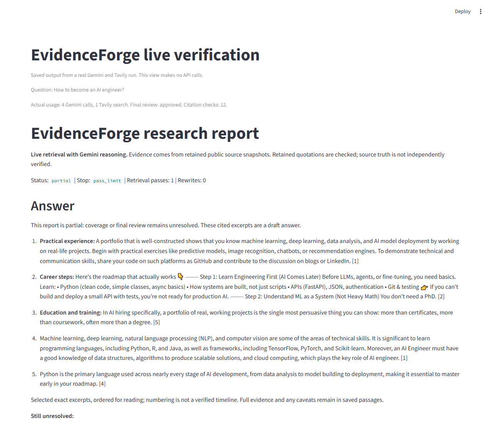
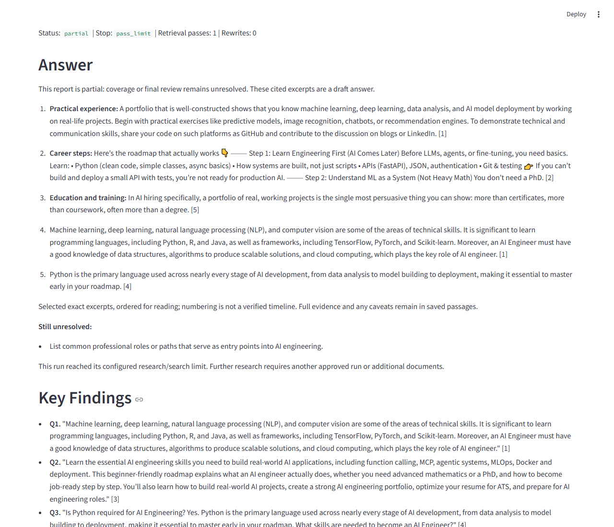
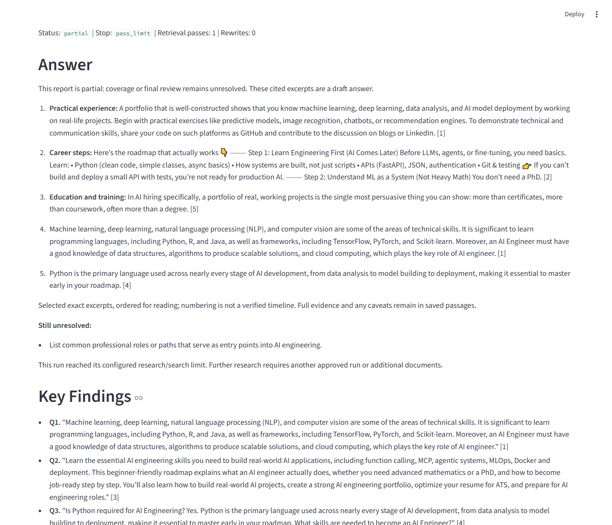

# Report and bounded revision repair - 20 October 2026

App version: **2026-10-20.1**. New workbench runs use production policy **6**.

## Repairs

1. **Promotions:** third-party bootcamp pitches and credential sales wording are
   excluded from highlighted answers. The same guard filters inputs to new
   coverage and synthesis stages. Raw source snapshots remain retained.
2. **Answer structure:** how-to answers prioritize distinct approved criteria.
   Readable topic labels precede exact cited excerpts. Generic words such as AI
   and development cannot assign a programming quotation to a mathematics heading.
   A Python sentence mentioning deployment cannot substitute for portfolio guidance.
3. **Evidence detail:** extraction prioritizes specific approved criteria within
   the existing per-source passage cap. Mathematical and portfolio details can be
   admitted without repeating the broad question. Admission is lexical relevance,
   not an independent factual verification.
4. **Viable revision:** the first search uses the approved, possibly edited plan.
   Avoiding a separate query-generation call leaves room for one revision and its
   review: four model calls normally, six with that revision. Later retrieval
   passes still generate queries from unresolved gaps.
5. **Visible controls:** the one-revision checkbox handles older hosted settings
   with zero rewrites. Unchecking it disables the revision. Model-call, token and
   search caps are not increased.
6. **Coverage contract:** outputs select explicit criterion and short evidence IDs.
   Local code maps criteria to saved zero-based indices and validates provenance.
   Unknown IDs, duplicate criteria and cross-question evidence are rejected.
   High array-size bounds are omitted from the provider schema; local validation
   stays in force.
7. **Saved workflows:** policies 0-5 preserve their historical behavior. Existing
   resumes use their registered policy and durable receipts. Display improvements
   do not rewrite old usage or upgrade partial runs to completed.

## Live diagnostic evidence

Two diagnostics on 19 October each used four Gemini calls and one Tavily search.
The first exposed one-based indices returned for a zero-based coverage contract.
The second exposed an HTTP 400 rejection of the initial explicit-ID wire schema.
Both reports remained partial, with their failures preserved.

The simplified schema then passed **one live Gemini coverage call over saved
Tavily evidence**. All five returned criterion IDs mapped to valid canonical
indices. This diagnostic made **zero new searches**.

Total consumed by these diagnostics: **9 Gemini calls and 2 Tavily searches**.
Historical benchmark and verification allowances were not modified or reset.
The fresh verification below was run after all follow-up changes.

[Google's structured-output guidance](https://ai.google.dev/gemini-api/docs/generate-content/structured-output?hl=en)
recommends simplifying schemas when the API rejects their complexity. Provider
schema acceptance is separate from semantic correctness and local validation.

## Fresh live verification - 20 October

Question: **How to become an AI engineer?** Model: **gemini-3.1-flash-lite**.
This was a new live run of the same research service and production policy used
by the hosted workbench, executed locally with private configured credentials.
It was not a submission through the public Streamlit browser form.

| Measurement | Actual result |
| --- | --- |
| Gemini calls | 4 of at most 6 |
| Tavily searches | 1 of at most 1 |
| Retrieved sources / retained passages | 5 / 40 |
| Tool errors | 0 |
| Exact-quotation citation checks | 12, all passed |
| Final critic decision | Approved |
| Criterion coverage | 3 of 4 |
| Report status / stop reason | Partial / pass limit |
| Rewrites | 0; the critic approved the first draft |

**What worked:** planning, live search, the corrected coverage wire schema, quote
selection and final review all returned without tool errors. The Answer precedes
Key Findings, and the report retains its citations and explicit gap.

**What remains unresolved:** the sources did not establish the planned criterion
"List common professional roles or paths that serve as entry points into AI
engineering." The single allowed retrieval pass was exhausted, so the workflow
correctly retained a partial status even though the critic approved the draft.
Critic approval and full criterion coverage are separate checks. More model
calls alone do not supply the missing evidence.

The model's criterion assessments and the display labels are not independently
verified semantic judgments. Some source passages contain opinions, persuasive
language and unreconciled statistics. Passing quotation checks proves that the
words match retained passages; it does not prove the underlying advice or numbers.

### Screenshots of the actual saved result

The [sanitized result counters](evidence/submission-live-2026-10-20.json) record
the measured usage, status and remaining criterion labels without credentials or
raw provider receipts.

These are read-only local renderings of the real saved live run with the same
report renderer as the app. Capturing them made no additional provider calls.

This fresh run consumed **4 Gemini calls and 1 Tavily search**. Repair-wide totals
are now **13 Gemini calls and 3 Tavily searches**, within the approved caps of
15 and 3 respectively. Two Gemini calls remain unused; no Tavily searches remain.
Earlier benchmark and verification allowances were not reset. There was no
automatic fresh retry, and the report was not relabeled as completed.

## Local verification

- **15 submission regressions passed**: promotions, exact offsets, criterion
  labels, criteria-first extraction, wire-schema bounds, invalid references,
  approval, bounded revision, refusal of extra work, and terminal reconnect.
- **10 legacy planning regressions passed**, including policy 2-5 approval/resume.
- Earlier focused report/UI checks passed 41 tests before the live diagnostics.
- Strict mypy passed all **90 source files**. Lint passed.
- **20 provider/report recovery checks passed locally**, including a fresh explicit
  retry after a simulated HTTP 503 with the criterion-ID wire contract. These
  mocked checks use no paid provider calls.
- [Full GitHub CI passed 612 tests](https://github.com/cakhiltej9001-source/evidenceforge-ai/actions/runs/39387653439)
  on source commit `c181da7`. Lint, formatting, types, build, deployment smoke and
  container checks also passed. The first CI run exposed two stale test contracts;
  the recovery mock and partial-answer wording assertions were corrected.

## Hosted activation

On 20 October the free app was asleep from inactivity. It was awakened, and an
independent browser check confirmed **App version: 2026-10-20.1**, the empty
question input, configured Gemini, Tavily search, and the enabled one-revision
control. No research form was submitted during this hosted check.

This screenshot verifies the deployed UI. The separate fresh verification above
records the actual live result and its remaining evidence gap. A fully covered
completed report is not claimed.

Original exports, provider receipts and diagnostic artifacts remain Git-ignored.
Only sanitized counters and reviewed screenshots are suitable for public docs.

## Limits

These conservative heuristics do not establish source truth, universal career
requirements, a complete roadmap or general research accuracy. Missing evidence
stays a gap. A review that cannot finish within its allowance remains partial.

Hosting remains free only. Hosted storage is temporary; download reports before
leaving the session.
