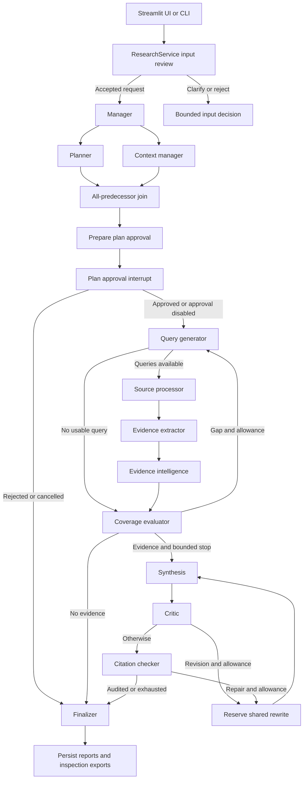
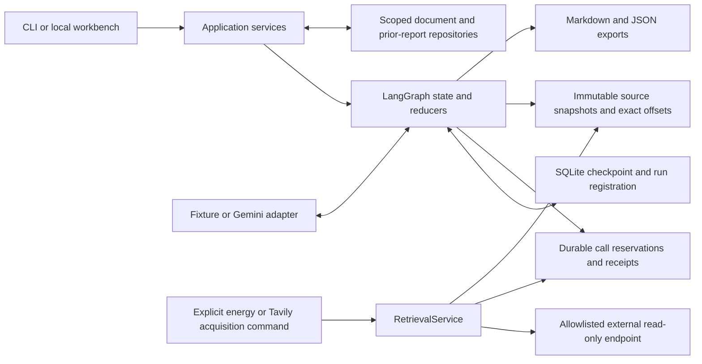

# Architecture

This diagram follows the implemented Phase 8 graph and service boundary.
The input review runs before graph invocation. Provider clients, repository
connections and runtime workers are injected outside serialized state.

Synthesis failures route to citation checking if a draft exists, otherwise to
finalization. Non-running/error/cancelled states also route to finalization.
The diagram summarizes healthy paths; error routes are enforced in
`src/evidenceforge/graph/research.py`. Finalization preserves only audited claims
and may return completed, partial, insufficient_evidence, failed or cancelled.

## Storage and access

The full research graph retrieves local documents or synthetic sources. External
acquisition is a separate explicit workflow; it is not currently wired as general
live web research in the UI. Prior reports are context/navigation, never admitted
as fresh evidence. Owner IDs are storage boundaries and must match requests,
documents, checkpoints and exports; they do not authenticate users.

## Where behavior lives

| Responsibility | Current implementation |
|---|---|
| Research routing | `src/evidenceforge/graph/research.py` |
| State/contracts | `src/evidenceforge/graph/state.py`, `schemas.py` |
| Application lifecycle | `src/evidenceforge/services/research.py` |
| Planning and context | `nodes/planner.py`, `nodes/context.py`, `nodes/queries.py` |
| Retrieval and evidence | `nodes/sources.py`, `nodes/extraction.py`, `retrieval/` |
| Coverage/quality | `nodes/quality.py`, `reporting.py` |
| Evidence graph/comparisons | `evidence/`, `nodes/intelligence.py` |
| Call/restart persistence | `storage/checkpoints.py`, `storage/calls.py`, `storage/model_calls.py` |
| UI and worker facade | `ui.py`, `workbench.py`, `ui_launcher.py` |
| Gemini reasoning | `models/gemini.py` |
| GB energy acquisition | `retrieval/carbon_intensity.py`, `energy_demo.py` |
| Evaluation | `evaluation.py`, `evaluation_paid.py`, `evaluation_extension.py` |

Rows with short filenames are relative to `src/evidenceforge/`.
The claim graph is a projection of authoritative records, not a second mutable
truth store. Ranking, lexical admission and explicit numeric comparisons are
heuristics; successful citation checks do not independently establish source truth.
